# 编译工具链的构建原理

> 本文系统性地阐述编译工具链（toolchain）的构建原理：从基本概念、分类、分层结构，到完整的构建流程，并以开源项目 [gnu-devtools-for-arm](https://github.com/gengshuhui/gnu-devtools-for-arm.git) 为实例，逐行剖析其构建脚本的原理、关键配置参数与输入输出。文档会持续维护。

---

## 目录

1. [什么是工具链](#1-什么是工具链)
2. [三元组与工具链分类](#2-三元组与工具链分类)
3. [工具链的分层结构](#3-工具链的分层结构)
4. [四种工具链类型详解](#4-四种工具链类型详解)
   - 4.1 [原生工具链 (Native)](#41-原生工具链-native)
   - 4.2 [交叉工具链 (Cross)](#42-交叉工具链-cross)
   - 4.3 [加拿大交叉 (Canadian Cross)](#43-加拿大交叉-canadian-cross)
   - 4.4 [LLVM/Clang 工具链](#44-llvmclang-工具链)
5. [交叉工具链的核心构建流程（难点详解）](#5-交叉工具链的核心构建流程难点详解)
   - 5.1 [为什么需要"自举/Bootstrap"](#51-为什么需要自举bootstrap)
   - 5.2 [裸机工具链构建流程图](#52-裸机工具链构建流程图)
   - 5.3 [Linux 交叉工具链构建流程图](#53-linux-交叉工具链构建流程图)
6. [实例剖析：gnu-devtools-for-arm](#6-实例剖析gnu-devtools-for-arm)
   - 6.1 [仓库结构与组件](#61-仓库结构与组件)
   - 6.2 [源码获取：source-fetch.py 与 SPC 清单](#62-源码获取source-fetchpy-与-spc-清单)
   - 6.3 [顶层驱动脚本 build-gnu-toolchain.sh](#63-顶层驱动脚本-build-gnu-toolchainsh)
   - 6.4 [裸机工具链 build-baremetal-toolchain.sh 逐阶段剖析](#64-裸机工具链-build-baremetal-toolchainsh-逐阶段剖析)
   - 6.5 [Linux 工具链 build-cross-linux-toolchain.sh 逐阶段剖析](#65-linux-工具链-build-cross-linux-toolchainsh-逐阶段剖析)
   - 6.6 [工具函数库 utilities.sh](#66-工具函数库-utilitiessh)
   - 6.7 [关键配置参数速查表](#67-关键配置参数速查表)
   - 6.8 [典型调用示例与输入输出](#68-典型调用示例与输入输出)
7. [测试与仿真](#7-测试与仿真)
8. [补充知识：硬件与软件背景](#8-补充知识硬件与软件背景)
9. [实例剖析：从源码构建 LLVM/Clang 工具链](#9-实例剖析从源码构建-llvmclang-工具链)
   - 9.1 [LLVM 的单体仓库与构建系统](#91-llvm-的单体仓库与构建系统)
   - 9.2 [两阶段自举构建流程](#92-两阶段自举构建流程)
   - 9.3 [关键 CMake 参数详解](#93-关键-cmake-参数详解)
   - 9.4 [完整构建实例与输入输出](#94-完整构建实例与输入输出)
   - 9.5 [用 LLVM 做交叉编译](#95-用-llvm-做交叉编译)
   - 9.6 [GNU 与 LLVM 构建范式对比](#96-gnu-与-llvm-构建范式对比)
10. [实例剖析：crosstool-NG 自动化构建原理](#10-实例剖析crosstool-ng-自动化构建原理)
    - 10.1 [crosstool-NG 是什么](#101-crosstool-ng-是什么)
    - 10.2 [kconfig 配置系统](#102-kconfig-配置系统)
    - 10.3 [内部构建步骤流水线](#103-内部构建步骤流水线)
    - 10.4 [完整使用实例与输入输出](#104-完整使用实例与输入输出)
    - 10.5 [与手写脚本/其他方案的对比](#105-与手写脚本其他方案的对比)
11. [深入：GCC 三阶段自举的内部机制](#11-深入gcc-三阶段自举的内部机制)
    - 11.1 [为什么原生 GCC 要自举三次](#111-为什么原生-gcc-要自举三次)
    - 11.2 [三个阶段分别做什么](#112-三个阶段分别做什么)
    - 11.3 [比较阶段：二进制一致性验证](#113-比较阶段二进制一致性验证)
    - 11.4 [目录布局与 Makefile 机制](#114-目录布局与-makefile-机制)
    - 11.5 [自举中的循环依赖与生成文件](#115-自举中的循环依赖与生成文件)
    - 11.6 [BUILD / HOST / TARGET 编译器的三重身份](#116-build--host--target-编译器的三重身份)
    - 11.7 [自举与交叉构建的关系](#117-自举与交叉构建的关系)
    - 11.8 [实操、常用选项与排错](#118-实操常用选项与排错)
12. [实例剖析：Buildroot 构建系统](#12-实例剖析buildroot-构建系统)
    - 12.1 [Buildroot 的定位与工具链三种来源](#121-buildroot-的定位与工具链三种来源)
    - 12.2 [package 基础设施与 .mk/Config.in 机制](#122-package-基础设施与-mkconfigin-机制)
    - 12.3 [工具链在 Buildroot 中的构建顺序](#123-工具链在-buildroot-中的构建顺序)
    - 12.4 [完整实例与输入输出](#124-完整实例与输入输出)
    - 12.5 [SDK、external toolchain 与 per-package 目录](#125-sdkexternal-toolchain-与-per-package-目录)
13. [RISC-V 工具链的差异](#13-risc-v-工具链的差异)
    - 13.1 [模块化 ISA 与命名规则](#131-模块化-isa-与命名规则)
    - 13.2 [-march/-mabi 的强耦合](#132--march-mabi-的强耦合)
    - 13.3 [riscv-gnu-toolchain 实例](#133-riscv-gnu-toolchain-实例)
    - 13.4 [与 ARM 工具链的对比小结](#134-与-arm-工具链的对比小结)
14. [llvm-libc 现状](#14-llvm-libc-现状)
    - 14.1 [为什么 LLVM 要自造 libc](#141-为什么-llvm-要自造-libc)
    - 14.2 [设计特点：细粒度与 full/overlay 两种模式](#142-设计特点细粒度与-fulloverlay-两种模式)
    - 14.3 [成熟度与典型用途](#143-成熟度与典型用途)
    - 14.4 [在工具链中的位置](#144-在工具链中的位置)
15. [实例剖析：Yocto/OpenEmbedded 工具链](#15-实例剖析yoctoopenembedded-工具链)
    - 15.1 [Yocto 与 OpenEmbedded 的关系](#151-yocto-与-openembedded-的关系)
    - 15.2 [recipe、task 与 BitBake 执行模型](#152-recipetask-与-bitbake-执行模型)
    - 15.3 [三种编译器与 gcc-cross/gcc-crosssdk](#153-三种编译器与-gcc-crossgcc-crosssdk)
    - 15.4 [工具链构建的 recipe 链与流程](#154-工具链构建的-recipe-链与流程)
    - 15.5 [sysroot、sstate 缓存与 SDK](#155-sysrootsstate-缓存与-sdk)
    - 15.6 [完整实例与输入输出](#156-完整实例与输入输出)
16. [深入：PGO 与 BOLT 对编译器自身的优化](#16-深入pgo-与-bolt-对编译器自身的优化)
    - 16.1 [为什么要优化编译器自身](#161-为什么要优化编译器自身)
    - 16.2 [PGO：基于性能剖析的优化](#162-pgo基于性能剖析的优化)
    - 16.3 [GCC 的 profiledbootstrap](#163-gcc-的-profiledbootstrap)
    - 16.4 [Clang 的多阶段 PGO/LTO](#164-clang-的多阶段-pgolto)
    - 16.5 [BOLT：链接后二进制布局优化](#165-bolt链接后二进制布局优化)
    - 16.6 [组合效果与流水线全景](#166-组合效果与流水线全景)
17. [裸机启动与链接脚本细节](#17-裸机启动与链接脚本细节)
    - 17.1 [从上电到 main 的完整链条](#171-从上电到-main-的完整链条)
    - 17.2 [内存布局与链接脚本结构](#172-内存布局与链接脚本结构)
    - 17.3 [启动代码 crt0/startup 做什么](#173-启动代码-crt0startup-做什么)
    - 17.4 [实例：一个最小 Cortex-M 链接脚本](#174-实例一个最小-cortex-m-链接脚本)
    - 17.5 [与工具链构建选项的关联](#175-与工具链构建选项的关联)
18. [Windows / LLVM-MinGW 工具链](#18-windows--llvm-mingw-工具链)
    - 18.1 [Windows 工具链的三条路线](#181-windows-工具链的三条路线)
    - 18.2 [MinGW-w64 的构成](#182-mingw-w64-的构成)
    - 18.3 [LLVM-MinGW：基于 LLVM 的 MinGW](#183-llvm-mingw基于-llvm-的-mingw)
    - 18.4 [实例与输入输出](#184-实例与输入输出)
    - 18.5 [与前文加拿大交叉的衔接](#185-与前文加拿大交叉的衔接)
19. [术语表](#19-术语表)

---

## 1. 什么是工具链

**工具链（toolchain）** 是一组相互配合、把高级语言源代码转换成可在目标机器上运行的二进制程序的软件工具集合。它们"链"在一起，前一个工具的输出是后一个工具的输入，故得名。

一条最小的 C/C++ 编译工具链至少包含：

| 工具 | 作用 | 输入 → 输出 |
|------|------|-------------|
| **预处理器 cpp** | 展开宏、头文件 | `.c` → 预处理后的 `.i` |
| **编译器 cc1 / gcc** | 翻译为汇编 | `.i` → `.s`（汇编） |
| **汇编器 as (gas)** | 翻译为机器码目标文件 | `.s` → `.o`（ELF 可重定位目标） |
| **链接器 ld** | 合并目标文件与库，重定位符号 | `.o` + 库 → 可执行文件 / 共享库 |
| **C 运行时库 (libc)** | 提供 `printf`、`malloc`、系统调用封装 | 被链接进最终程序 |
| **其他运行时** | libgcc（编译器内建例程）、libstdc++（C++ 标准库） | 被链接进程序 |

此外还有一系列**辅助二进制工具（binutils）**：`objdump`（反汇编）、`readelf`（查看 ELF）、`nm`（符号表）、`ar`（静态库打包）、`objcopy`、`strip`、`ranlib` 等，以及**调试器 GDB**。

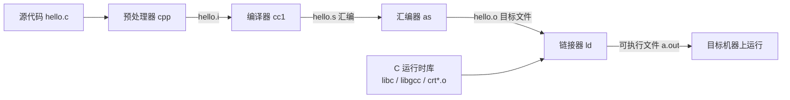

**一个关键认识**：GCC 这个"编译器"其实只是驱动程序，它本身并不能独立产生可运行程序。它必须依赖 binutils（汇编器+链接器）和一套 C 库（glibc 或 newlib）才能构成完整工具链。因此"构建工具链"本质上是**协调编译 binutils、GCC、C 库这三大件，并处理它们之间错综复杂的依赖关系**。

---

## 2. 三元组与工具链分类

理解工具链，首先要理解 GNU 配置系统中的三个"机器"概念。每个机器用一个 **GNU 三元组（triple）** 描述，格式通常为 `机器-厂商-操作系统` 或 `机器-厂商-内核-ABI`，例如：

- `x86_64-none-linux-gnu`：x86-64 架构、Linux 内核、GNU libc ABI
- `aarch64-none-linux-gnu`：ARM 64 位、Linux、GNU libc
- `arm-none-eabi`：ARM 32 位、无操作系统（裸机）、EABI
- `aarch64-none-elf`：ARM 64 位、裸机、ELF 格式

构建一条工具链时，涉及三类机器：

| 概念 | 含义 | 记号 |
|------|------|------|
| **Build（构建机）** | 执行编译工具链这个动作的机器 | `--build` |
| **Host（宿主机）** | 编译出来的工具链将来运行在哪台机器上 | `--host` |
| **Target（目标机）** | 工具链编译出的程序将来运行在哪台机器上 | `--target` |

根据这三者是否相同，工具链分为四大基本类型：

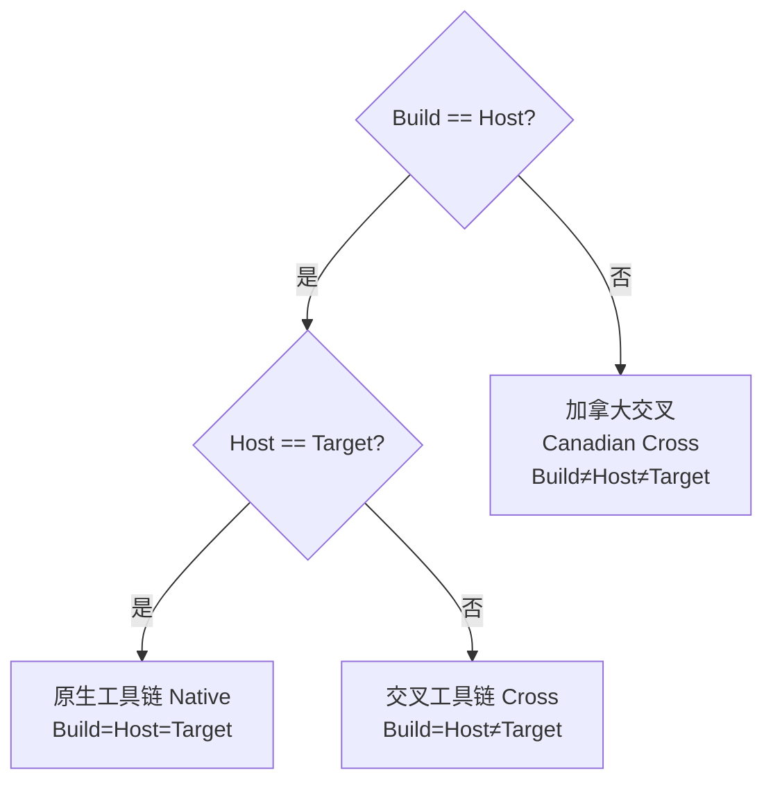

| 类型 | Build | Host | Target | 典型场景 |
|------|-------|------|--------|----------|
| **原生 Native** | A | A | A | 在 x86 Linux 上编译跑在 x86 Linux 的程序（如发行版自带 gcc） |
| **交叉 Cross** | A | A | B | 在 x86 PC 上编译跑在 ARM 单片机的固件 |
| **加拿大交叉 Canadian** | A | B | C | 在 x86 Linux 上构建"运行于 Windows、但生成 ARM 代码"的工具链 |
| **本机交叉 crossback** | A | B | A | 较少见，Host 与 Target 相同但都不等于 Build |

> "加拿大交叉"得名于命名时加拿大有三个政党，恰好对应三个不同的机器身份。

---

## 3. 工具链的分层结构

从依赖关系看，一条工具链可分为四层，构建时必须自底向上：

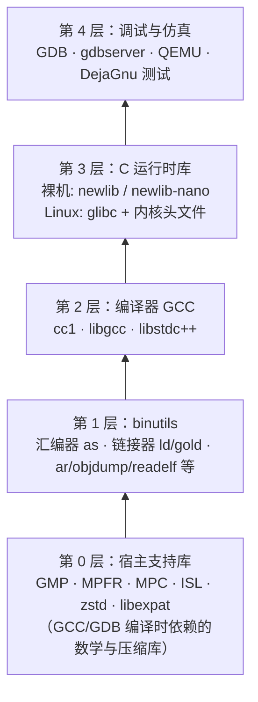

- **第 0 层 宿主支持库**：GCC 的中端优化和 GDB 需要多精度算术库 GMP、浮点库 MPFR、复数库 MPC、整数集库 ISL（Graphite 循环优化）、压缩库 zstd、XML 解析库 libexpat。它们编译在"宿主机"上运行，通常静态链接进 GCC/GDB 以提高可移植性。
- **第 1 层 binutils**：必须先于 GCC，因为 GCC 生成汇编后需要 `as` 汇编、`ld` 链接。
- **第 2 层 GCC**：依赖第 0、1 层。
- **第 3 层 C 库**：这里出现"鸡生蛋"困境——编译 C 库需要编译器，但完整的编译器又需要 C 库才能编译出运行时（libgcc/libstdc++）。解决方案是**分阶段自举**（见第 5 节）。
- **第 4 层 调试/测试**：GDB、QEMU 以及基于 DejaGnu 的回归测试。

---

## 4. 四种工具链类型详解

### 4.1 原生工具链 (Native)

`Build = Host = Target`。这是最简单的情形，例如 Ubuntu 上 `apt install gcc` 得到的编译器。构建时无需交叉，因为编译器运行的机器和它生成代码的机器是同一种。GCC 的标准 bootstrap（3 阶段自举编译）就属于这种：用系统已有的 gcc 编译出 stage1 gcc，再用 stage1 编译 stage2，再用 stage2 编译 stage3，比较 stage2/stage3 的二进制是否一致以验证正确性。

> 注意：示例仓库 gnu-devtools-for-arm 当前**不支持**纯原生构建（脚本里保留了 `build-native-toolchain.sh` 的入口但会直接报错退出，见 6.3 节）。

### 4.2 交叉工具链 (Cross)

`Build = Host ≠ Target`。这是嵌入式开发的主力，也是本文与示例仓库的重点。它又细分为两类：

- **裸机（bare-metal / freestanding）**：Target 没有操作系统，如 `arm-none-eabi`、`aarch64-none-elf`。C 库用轻量的 **newlib**（及更小的 newlib-nano），系统调用通过 **libgloss** 的桩（semihosting）实现。
- **Linux 目标（hosted）**：Target 运行 Linux，如 `aarch64-none-linux-gnu`。C 库用 **glibc**，需要 **Linux 内核头文件** 来定义系统调用接口。

两者构建流程差异很大，示例仓库因此分成 `build-baremetal-toolchain.sh` 和 `build-cross-linux-toolchain.sh` 两个脚本。

### 4.3 加拿大交叉 (Canadian Cross)

`Build ≠ Host ≠ Target`。最典型的用途是**制作 Windows 上运行的 ARM 交叉编译器**：在 x86 Linux（Build）上，编译出能在 Windows（Host，`x86_64-w64-mingw32`）上运行、但生成 ARM（Target）代码的工具链。

难点在于：要编译出运行在 Windows 上的工具链，你需要一个"能生成 Windows 代码"的编译器（MinGW 交叉编译器）；同时为了给 Target 构建运行时库（libgcc、newlib），你还需要一个"能生成 Target 代码并能在 Build 上运行"的普通交叉编译器。因此 **Canadian Cross 必须先构建一条 Build=Host 的普通交叉工具链作为辅助**。

示例仓库的 README 明确了这个前置步骤：构建 MinGW 版工具链前，必须先为同一 Target 构建对应的 Linux 版工具链（用 `--host-toolchain-path` 把它的 bin 目录传进去）。

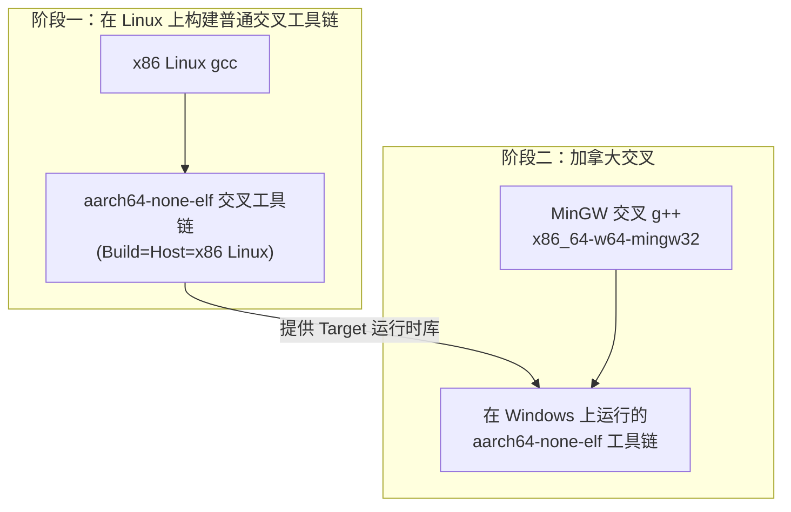

### 4.4 LLVM/Clang 工具链

GNU 体系之外的现代替代方案。核心差异：

| 维度 | GNU | LLVM |
|------|-----|------|
| 编译器 | gcc（每个 target 单独构建一个编译器二进制） | clang（**单一二进制天然支持多 target**，靠 `--target=` 切换） |
| 汇编/链接 | gas / ld.bfd / ld.gold | 内建汇编器 + lld |
| C++ 库 | libstdc++ | libc++ / libc++abi |
| 编译器运行时 | libgcc | compiler-rt |
| 二进制工具 | binutils | llvm-objdump / llvm-readobj / llvm-nm 等 |
| 架构 | 松耦合独立项目 | 统一 LLVM IR，模块化库 |

LLVM 的一大优势是**交叉编译极为简单**：一个 clang 安装即可面向所有架构，无需像 GNU 那样为每个 target 从头构建一条独立工具链。但在深度嵌入式、内核等场景，GNU 工具链仍是事实标准，这也是 gnu-devtools-for-arm 聚焦 GNU 的原因。

---

## 5. 交叉工具链的核心构建流程（难点详解）

### 5.1 为什么需要"自举/Bootstrap"

核心矛盾是 **GCC 与 C 库的循环依赖**：

- 要编译 glibc/newlib（C 库），需要一个针对 target 的 C 编译器。
- 要构建完整的 GCC（含 libgcc、libstdc++），又需要 C 库的头文件和启动文件（crt*.o）。

破解方法是**把 GCC 分成两次（甚至更多次）构建**：

1. **GCC 第一遍（minimal / stage1）**：只编译 C 语言前端，配置 `--without-headers --with-newlib`，不构建任何运行时库。它仅能把 C 源码编译成 `.o`，刚好够用来编译 C 库。
2. **用这个"残缺"编译器编译 C 库**（newlib 或 glibc）。
3. **GCC 第二遍（full / stage2）**：此时 C 库头文件已就绪，配置 `--with-headers`，构建完整的 libgcc、libstdc++ 等运行时，得到最终可用的编译器。

Linux glibc 场景更复杂，因为 glibc 自身也要分两步（先装头文件和启动文件，再编译完整库），所以会出现 gcc1 → libc-headers → gcc2 → libc → gcc3 的多轮交替。

### 5.2 裸机工具链构建流程图

对应 `build-baremetal-toolchain.sh` 的 `start` 阶段栈：
`gmp mpfr mpc isl cloog qemu iconv zstd binutils gdb gcc1 newlib newlib-nano gcc2 gcc2-nano perms`

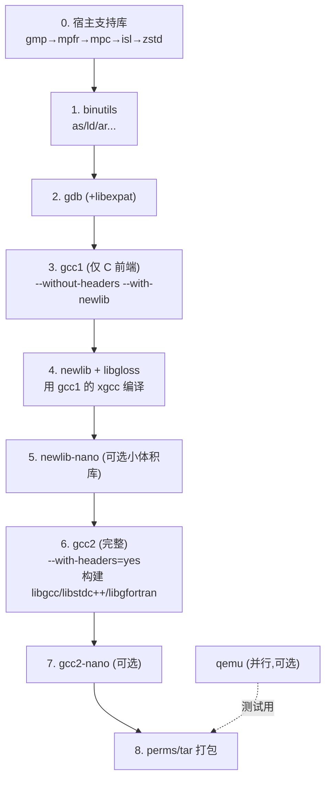

### 5.3 Linux 交叉工具链构建流程图

对应 `build-cross-linux-toolchain.sh`。关键在于 gcc1→内核头文件→libc头文件→gcc2→完整glibc→gcc3 的多轮自举：

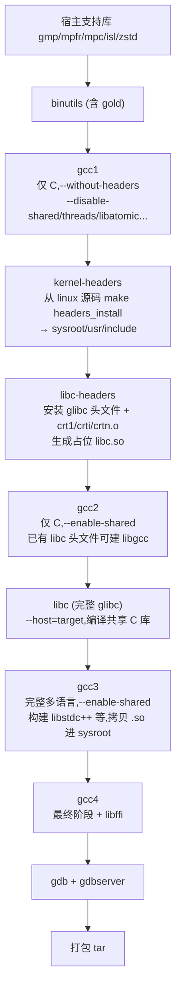

> **Sysroot 概念**：交叉编译时，target 的头文件和库不能放在宿主系统的 `/usr/include`、`/usr/lib`（那是宿主机的），而是集中放在一个"假根目录"——**sysroot**。编译器通过 `--sysroot=` 在该目录下查找 target 的头/库。脚本中 `build_sysroot=${installdir}/${target}/libc` 就是这个作用。`--with-build-sysroot` 用于构建期，`--with-sysroot` 烧录进编译器作为运行期默认值，二者分离是为了让工具链可重定位（relocatable）。

---

## 6. 实例剖析：gnu-devtools-for-arm

> 本节对应 task.md 要求的"引用实际例子，详细解释脚本原理、关键配置参数、输入输出"。所有行号引用均基于克隆到本地的仓库快照。

[gnu-devtools-for-arm](https://github.com/gengshuhui/gnu-devtools-for-arm.git) 是用于构建、测试、调试 **Arm GNU Toolchain** 的开源脚本集。它能产出与 Arm 官方发布版配置相近的工具链，供工具链开发者在模型上构建测试，也供用户从源码自行重建官方同款工具链。

### 6.1 仓库结构与组件

```
gnu-devtools-for-arm
├── build-gnu-toolchain.sh              # 顶层驱动（用户入口）
├── build-baremetal-toolchain.sh        # 裸机工具链底层脚本（newlib）
├── build-cross-linux-toolchain.sh      # Linux 工具链底层脚本（glibc）
├── build-newlib-for-mingw-toolchain.sh # 为 MinGW 工具链补充 newlib
├── utilities.sh                        # 公共 shell 函数库
├── python-config.sh                    # 为 MinGW 版 GDB 配置 Windows Python
├── dejagnu/                            # DejaGnu 测试：site*.exp 与 boards/*.exp
├── extras/
│   ├── models-run                      # Arm Fast Models 运行器
│   ├── gdb_plugin.so                   # Fast Models 的 GDB 插件
│   └── source-fetch.py                 # 按清单抓取各 GNU 项目源码
├── spc/                                # 源码快照清单（trunk.spc / morello.spc）
└── manifests/                          # 某次正式发布锁定的 commit 清单
```

组件可归为四类：**构建脚本**、**DejaGnu 测试配置（site 与 board 文件）**、**Fast Model 运行器 models-run**、**Fast Models 的 GDB 插件**。

### 6.2 源码获取：source-fetch.py 与 SPC 清单

工具链本身不含被编译项目的源码，需先把 binutils-gdb、gcc、glibc、newlib、linux 等放到 `./src` 目录。仓库提供两种方式，核心是 **SPC（源码快照）清单文件**。

`spc/trunk.spc` 用于构建"开发版/最新上游"工具链，它用 INI 风格描述每个组件从哪获取：

```ini
[binutils-gdb]
type=git
url=git://sourceware.org/git/binutils-gdb.git

[gcc]
type=git
url=git://gcc.gnu.org/git/gcc.git

[gmp]
type=tarball
url=https://gcc.gnu.org/pub/gcc/infrastructure/gmp-6.2.1.tar.bz2
```

- `type=git`：从 git 仓库克隆（可带 `--shallow` 做浅克隆）。
- `type=tarball`：下载并解压压缩包（GMP/MPFR/MPC/ISL 等数学库用此方式，版本固定）。

而 `manifests/arm-gnu-toolchain-src-snapshot-15.2.rel1-manifest.txt` 是**某次正式发布锁定的清单**，每个组件带有精确的 `version=<commit哈希或tag>`，保证可复现地重建官方 15.2.rel1 发布：

```ini
[gcc]
type=git
url=git://gcc.gnu.org/git/gcc.git
version=b0e3253dc990beb637b70d2e0c43e8ec586d169f

[linux]
type=git
url=.../linux-stable.git
version=v6.6.44
```

**source-fetch.py** 读取清单并执行抓取。它是一个较完整的 Python 工具，内部实现了 `git`、`tarball`、`subversion` 等多种源类型（`SpcItemTarball`、`SpcItemGitVersion`、`SpcItemGitBranch`、`SpcItemSubversionRevision`），并提供 `checkout` 与 `archive` 两个子命令：

- 输入：清单文件 + `--src-dir=..`（目标 src 目录）
- 输出：在 `./src` 下克隆/解压好的各组件目录
- 典型调用：`python3 extras/source-fetch.py checkout --shallow --src-dir=.. trunk.spc`

此外 GMP/MPC/MPFR/ISL/libexpat 等不在清单里的库，用 GCC 自带的 `./contrib/download_prerequisites` 补齐。

### 6.3 顶层驱动脚本 build-gnu-toolchain.sh

这是用户最常用的入口，职责是**把简单的 `--target` 请求翻译成对底层脚本的正确调用**，自身不做实际编译。

**① 路径与环境自举（1–53 行）**

```bash
set -e            # 任一命令失败立即退出
set -u            # 引用未定义变量即报错，提升健壮性
execdir=`pwd`                           # 当前工作目录 = buildroot
script_dir=$(dirname $(readlink -f "${BASH_SOURCE[0]}"))  # 脚本自身所在目录
source $script_dir/utilities.sh         # 载入公共函数
```

`PS4='+$(date ...):(${BASH_SOURCE}:${LINENO})...'` 定制了 `set -x` 调试输出，带时间戳和行号，便于排查长时间构建。

**② 选项解析（194–299 行）**：用 `getopt` 定义长选项。核心模式是两个"待填变量"寄存器：

```bash
if [ -n "${opt_prev:-}" ]; then   eval "$opt_prev=\$1"; ...      # 下一个参数赋给某变量
elif [ -n "${opt_append:-}" ]; then eval "$opt_append=...\$1"; ... # 追加到某变量（可重复，如多个 --target）
fi
```

这样 `--target=A --target=B` 会把 A、B 都累积进 `targets`。

**③ 按 target 分派到底层脚本（362–428 行）**——这是最关键的分类逻辑：

```bash
case $target in
*-linux-gnu | *-linux-gnu_ilp32 | *-linux-gnueabi*)
    script="build-cross-linux-toolchain.sh"      # Linux 目标 → glibc 脚本
    extraflags="$extraflags ${maybe_fortran} --disable-multiarch"
    ;;
*-elf | *-eabi)
    script="build-baremetal-toolchain.sh"        # 裸机目标 → newlib 脚本
    extraflags="$extraflags ${maybe_fortran}"
    ;;
*)
    printf "error: do not know how to build $target\n"; exit 1 ;;
esac
```

同时针对不同 target 自动注入默认配置，例如 `arm-none-linux-gnueabihf` 自动加上硬浮点：

```bash
arm*-none-linux-gnueabihf)
    arch="${arch:-armv7-a}"
    extraflags="$extraflags --config-flags-gcc=--with-float=hard"
    extraflags="$extraflags --config-flags-gcc=--with-fpu=neon"
    ;;
```

**④ Multilib 列表组装（430–466 行）**：A-profile 与 R/M-profile 的 multilib 开关会被拼成 `--with-multilib-list=aprofile,rmprofile` 传给 GCC。

**⑤ 最终调用（471 行）**——把所有内容转交底层脚本：

```bash
"$srcdir/gnu-devtools-for-arm/$script" \
    --builddir="$builddir" --target="$target" \
    $extraflags ${extra:-} --srcdir="$srcdir" "${make_targets[@]:-}"
```

> `--` 之后的参数会原样透传给底层脚本，这是 README 中 `build-gnu-toolchain.sh --target=... -- --release --package` 这种写法的原理。

**关于 Native**：脚本保留了 native 分支，但（403 行）`printf "error: Native builds not yet implemented"; exit 1`，即当前不支持原生构建。

### 6.4 裸机工具链 build-baremetal-toolchain.sh 逐阶段剖析

这是真正干活的脚本之一（约 1471 行），采用**可续跑的阶段状态机**设计。

**① 阶段栈机制**：脚本把构建拆成许多"阶段（stage）"，用一个 bash 数组 `stages` 作为栈。每执行一个阶段前，先把剩余阶段写入磁盘文件 `,stage`：

```bash
echo "${stages[*]}" >,stage   # 持久化当前进度
pop_stages                    # 弹出栈顶阶段执行
```

若构建中途失败，下次不带 `start` 再次运行时会读取 `,stage` 从断点续跑；而带 `start` 则强制从头。`push_stages` 允许一个阶段动态展开出若干子阶段（如 `start` 展开成一长串）。这种设计对耗时数小时的工具链构建极其重要。

**② `start` 阶段（793–797 行）** 定义主流程：

```bash
start)
    mk_bin_dirs $prefix
    write_build_status > build.status
    push_stages gmp mpfr mpc isl cloog qemu iconv zstd binutils gdb gcc1 newlib newlib-nano gcc2 gcc2-nano perms
    ;;
```

**③ 编译标志策略（556–577 行）**，体现 release 与 debug 的区别：

```bash
cflags_for_target_common="-ffunction-sections -fdata-sections"  # 每函数/数据独立 section，便于链接期 --gc-sections 裁剪
if [ $flag_debug_target_flag -eq 0 ]; then
  cflags_for_target="$cflags_for_target_common -O2 -g"          # 正常：O2
  cflags_for_nano_target="$cflags_for_target_common -Os -g"     # nano：Os 优化体积
else
  cflags_for_target="$cflags_for_target_common -O0 -g3"         # --debug-target：O0 便于调试库
fi
# host 侧组件
if [ $release_flag -eq 0 ]; then cflags="-O1 -g"; flag_check_final=yes
else cflags="-O2"; flag_check_final=release; fi
```

`--enable-checking=release` 关闭 GCC 内部一致性断言以提速，`=yes` 则开启，用于开发。

**④ newlib 的精细配置（579–632 行）**——这是裸机 libc 的灵魂，逐项都有注释说明：

| 配置项 | 作用 |
|--------|------|
| `--disable-newlib-supplied-syscalls` | 不用 newlib 自带系统调用，改用 libgloss 的 semihosting 实现 |
| `--enable-newlib-retargetable-locking` | 锁例程可在链接期替换 |
| `--enable-newlib-io-long-long` | printf/scanf 支持 `long long` |
| `--enable-newlib-io-c99-formats` | 支持 C99 格式说明符 |

newlib-**nano** 额外启用一批减小体积的开关：`--enable-newlib-nano-malloc`（小内存分配器）、`--enable-newlib-reent-small`（精简可重入结构）、`--enable-lite-exit`（精简退出，不调用清理函数）、`--disable-newlib-wide-orient` 等，专为资源受限的 MCU 设计。

**⑤ binutils 阶段（890–941 行）** 关键参数：

```bash
binutils_config="... \
    --enable-plugins \                       # 支持 LTO 插件
    --disable-gdb --without-gdb \            # 本阶段不建 gdb（单独阶段建）
    --target=$target \                       # 核心：目标三元组
    --prefix=$prefix \
    --with-sysroot=$prefix/$target"          # 指定 sysroot
binutils_build_targets="all-binutils all-gas all-gprof all-ld"
```

对 aarch64-elf 还会 `--enable-targets=arm-none-eabi,aarch64-none-linux-gnu,aarch64-none-elf` 让一个 binutils 同时识别多种 target，并 `--enable-64-bit-bfd` 支持 64 位 BFD。

**⑥ gcc1（第一遍，1028–1081 行）**——自举的起点：

```bash
gcc1_config="... \
    --target=$target --prefix=$installdir \
    --disable-shared --disable-nls --disable-threads \
    --enable-languages=$languages_gcc1 \     # 仅 c
    --without-cloog --without-isl \
    --with-newlib \                          # 告诉 gcc 将搭配 newlib
    --without-headers \                      # 关键：此时还没有 C 库头文件
    --with-gnu-as --with-gnu-ld \
    --with-sysroot=$installdir/$target"
gcc1_build_targets="all-gcc"                 # 只构建编译器本体,不建运行时
```

注意 1053 行 `sh ./contrib/gcc_update --touch`：它刷新 GCC 源码里自动生成文件的时间戳，避免 make 误以为需要重新生成（否则需要 maintainer 工具）。

**⑦ newlib（1083–1107 行）**——用刚建好的 gcc1 编译 C 库：

```bash
gccbin="$objdir/gcc1/gcc"
newlib_extra_config_envflags="CC_FOR_TARGET=\"$gccbin/xgcc -B$gccbin/\""  # 用 gcc1 的 xgcc 作目标编译器
newlib_build_targets="all-target-newlib all-target-libgloss"
```

`xgcc -B$gccbin/` 是尚未安装的"构建期编译器"，`-B` 指定其辅助程序搜索路径。

**⑧ gcc2（第二遍，1166–1224 行）**——完整编译器：

```bash
gcc2_config="... --with-newlib --with-headers=yes \       # 现在有头文件了
    --with-native-system-header-dir="/include" \
    --with-sysroot=$installdir/$target ..."
# 分三批 make,顺序有讲究:
gcc2_build_targets="all-gcc all-target-libgcc"                     # 先编译器+libgcc
...install-target-libstdc++-v3 ...install-target-libgfortran      # 安装运行时
gcc2_build_targets="all-target-libstdc++-v3 all-target-libquadmath all-target-libgfortran ..."  # 再 C++/Fortran 库
```

**⑨ newlib-nano 的库改名合并（1124–1163 行）**：nano 库编译后，脚本遍历 `gcc -print-multi-lib` 得到每个 multilib 目录，把 `libc.a`→`libc_nano.a`、`libg.a`→`libg_nano.a` 拷进主安装树，并复制 `nano.specs`。这样同一个工具链里，用户加 `--specs=nano.specs` 即可切换到 nano 库。

**⑩ perms/tar（1300–1355 行）**：release 时 strip 调试符号、规整权限，用 `tar -J`（xz 压缩）打包成 `<target>-tools.tar.xz`，QEMU 单独打包。

### 6.5 Linux 工具链 build-cross-linux-toolchain.sh 逐阶段剖析

与裸机脚本结构类似，但自举链更长（约 1581 行）。差异要点：

**① target → glibc 参数映射（568–680 行）**：根据 target 设定 Linux 架构名、QEMU 目标、动态链接器名等：

```bash
aarch64*-*-linux-gnu*)
    linux_arch=arm64
    qemu_target="aarch64-linux-user,aarch64_be-linux-user"
    enable_binutils_targets="arm-none-eabi,aarch64_be-none-linux-gnu,...,aarch64-none-elf"
    target_lib=lib64
    ;;
aarch64-*-linux-gnu)
    ldsoname="ld-linux-aarch64.so.1"    # 运行时动态链接器文件名
    ;;
arm-*-linux-gnueabihf)
    ldsoname="ld-linux-armhf.so.3"
    ;;
```

**② kernel-headers 阶段（1154–1165 行）**——Linux 工具链独有：

```bash
rsync -a --exclude=.git --delete-after "$linux_src/" "$objdir/linux/"
kernel_headers_extra_install_envflags="ARCH=$linux_arch CROSS_COMPILE=$target- \
                                       INSTALL_HDR_PATH=$stage_include"
kernel_headers_install_targets="headers_install"   # make headers_install
# 再 rsync 到 sysroot/usr/include
```

这一步把内核的 UAPI（用户空间 API）头文件装进 sysroot，glibc 编译时需要它们来了解系统调用号、ioctl 等。

**③ libc-headers 阶段（1191–1239 行）**——glibc 两步法的第一步：

```bash
libc_headers_install_targets="install-headers install_root=${build_sysroot} install-bootstrap-headers=yes"
# 单独编译启动文件:
make -C "$objdir/$libname-headers" csu/subdir_lib
cp .../csu/crt1.o crti.o crtn.o "$build_sysroot/$target_libdir"
# 生成一个空的占位 libc.so,让 gcc2 的链接测试能通过:
$target-gcc -nostdlib -nostartfiles -shared -x c /dev/null -o .../libc.so
```

这是一个巧妙的 trick：此时真正的 glibc 还没编译，但 gcc2 配置时会做链接测试，于是先放一个"空壳" libc.so 和启动文件顶上。

**④ 多轮 GCC（gcc1→gcc2→gcc3→gcc4）**：

- `gcc1`（1113–1152）：仅 C、`--without-headers`、禁用一切运行时库，最小编译器。
- `gcc2`（1245–1278）：仅 C、`--enable-shared`，此时有了 libc 头文件可建 libgcc。
- `libc`（1317–1357）：用 gcc2 编译**完整 glibc**，`--host=$target --build=$build`。
- `gcc3`（1363–1404）：完整多语言、`--enable-gnu-indirect-function`，并把生成的 `.so` 拷入 sysroot。
- `gcc4`（1406–1438）：最终阶段 + libffi。

**⑤ gdbserver（1078–1107 行）**：Linux 工具链会额外构建运行在 target 上的 `gdbserver`，用 `--sysroot` 交叉编译，`--host=$target`，供远程调试。

**⑥ Morello/纯能力（purecap）支持**：脚本内含大量 `multilib_purecap`、`libc-purecap` 分支，用于 Arm 的 CHERI/Morello 实验架构（能力指针），构建 lib64c 变体。普通用户可忽略。

### 6.6 工具函数库 utilities.sh

所有脚本共享的函数库（419 行），核心封装了"配置—编译—安装"三连：

```bash
do_config_build_install() {   # 对每个组件统一调用
    do_config "$@"            # 创建 objdir,运行 configure
    do_make "$@"             # make
    do_install "$@"          # make install DESTDIR=...
}
```

**约定优于配置**：`do_config` 通过 `eval` 从 `<组件>_srcdir`、`<组件>_config`、`<组件>_cflags` 等变量名动态取值。例如处理 `gmp` 时自动读取 `gmp_srcdir`、`gmp_config`。这让主脚本里每个阶段只需设置几个 `xxx_` 变量即可复用同一套构建逻辑。

其他关键函数：

- `find_source_tree` / `find_component`（128–179）：在 src 下按前缀模糊匹配组件目录（支持 `gcc-13.2`、`arm-gnu-toolchain-src-snapshot-*` 等带版本号后缀的命名）。
- `determine_version`（181–203）：若未指定 `--tag`，自动用 git HEAD 哈希作为 `--with-pkgversion`，烧进 `gcc --version` 输出。
- `number_of_cores`（30–39）：决定 `make -j` 并行度。
- `ternary`（119–126）：模拟 `C ? T : F`，用于根据 MinGW 与否切换编译器路径。
- 构建期每个 configure/make 都会把实际参数追加写入 `.build_flags` 文件，用于生成发布清单与复现。

### 6.7 关键配置参数速查表

| 参数 | 所属 | 含义 |
|------|------|------|
| `--target=` | 全体 | **目标三元组**，决定生成哪种机器的代码 |
| `--host=` | 底层脚本 | 工具链运行的机器（Canadian/MinGW 时指定） |
| `--prefix=` | configure | 安装前缀 |
| `--with-sysroot=` | gcc/binutils | 运行期查找 target 头/库的假根目录 |
| `--with-build-sysroot=` | 同上 | 构建期的 sysroot（与上分离以支持重定位） |
| `--without-headers` | gcc1 | 无 C 库头文件时的最小编译器 |
| `--with-newlib` | gcc | 搭配 newlib 而非 glibc |
| `--enable-languages=` | gcc | 启用的语言前端（c / c,c++ / +fortran） |
| `--disable-multilib` | gcc | 只建一个 multilib，大幅缩短开发迭代时间 |
| `--with-multilib-list=aprofile,rmprofile` | gcc | ARM 的 A/R/M profile 多库 |
| `--enable-checking=release\|yes` | gcc | 关闭/开启内部断言（速度 vs 安全） |
| `--enable-newlib-nano-*` | newlib | 一系列体积优化开关 |
| `--release --package` | 底层脚本 | 发布模式 + 打 tar 包 |
| `--debug --debug-target` | 全体 | host 组件 / target 库 用 `-O0 -g3` 构建 |
| `--enable-gdb-with-python=yes` | gdb | 构建带 Python 脚本支持的 GDB |

### 6.8 典型调用示例与输入输出

**示例 1：开发模式构建一条 AArch64 Linux 工具链**

```bash
build-gnu-toolchain.sh --target=aarch64-none-linux-gnu start
```

- **输入**：`./src` 下的 gcc、glibc、binutils-gdb、linux、gmp/mpfr/mpc/isl 等源码。
- **过程**：驱动脚本识别 `*-linux-gnu` → 调 `build-cross-linux-toolchain.sh`；走 gcc1→kernel-headers→libc-headers→gcc2→libc→gcc3→gcc4→gdb 全链。
- **输出**：`./build-aarch64-none-linux-gnu/install/` 下得到 `bin/aarch64-none-linux-gnu-gcc` 等完整工具链。

**示例 2：发布模式构建 arm-none-eabi（裸机，含 nano 库）**

```bash
build-gnu-toolchain.sh --target=arm-none-eabi --aprofile --rmprofile \
    -- --release --package --enable-newlib-nano --enable-gdb-with-python=yes
```

- 这是 Arm 官方发布 arm-none-eabi 工具链的实际配置。
- **输出**：`<target>-tools.tar.xz`（工具链）与 `<target>-qemu.tar.xz`（配套 QEMU）。

**示例 3：单 multilib 快速迭代（开发 GCC 时）**

```bash
# 首次完整构建:
build-gnu-toolchain.sh --target=arm-none-eabi \
    --with-arch=armv8.1-m.main+mve.fp+fp.dp --disable-multilib \
    -- --config-flags-gcc=--with-float=hard start
# 改了 GCC 代码后,只重跑 gcc2 阶段,秒级迭代:
build-gnu-toolchain.sh --target=arm-none-eabi \
    --with-arch=armv8.1-m.main+mve.fp+fp.dp --disable-multilib \
    -- --config-flags-gcc=--with-float=hard gcc2
```

这利用了阶段状态机：末尾的 `gcc2` 直接跳到该阶段，避免重建整条链。arm-none-eabi 默认有 39 个 multilib，全建需数小时，`--disable-multilib` 可缩减到一个。

**示例 4：Canadian Cross 构建 Windows 版工具链**

```bash
# 1) 先建 Linux 版辅助工具链
build-gnu-toolchain.sh --target=aarch64-none-elf
# 2) 再建 MinGW 版,传入上一步的 bin 目录
build-gnu-toolchain.sh --target=aarch64-none-elf -- \
    --builddir=/path/build-mingw-aarch64-none-elf \
    --host=x86_64-w64-mingw32 \
    --host-toolchain-path=/path/aarch64-none-elf/install/bin
# 3) 为 MinGW 工具链补 newlib
build-newlib-for-mingw-toolchain.sh --target=aarch64-none-elf \
    --builddir=/path/build-mingw-aarch64-none-elf
```

---

## 7. 测试与仿真

工具链构建出来后必须验证正确性。由于都是交叉编译器，target 代码不能直接在构建机上跑，需要**模型/仿真器**：

- **QEMU**：开源仿真器，脚本会从源码编译（`qemu` 阶段），产物在 `build-<target>/install-qemu/bin/`。支持 user 模式（`aarch64-linux-user`）直接跑 target ELF。
- **Arm Fast Models**：Arm 官方周期精确模型，仅 x86_64 Linux，部分需许可证。仓库提供 `extras/models-run` 运行器和 `extras/gdb_plugin.so`（默认在 TCP 10000 端口起 GDB server）。

测试框架用 **DejaGnu**（基于 Expect/Tcl）：


- `site-exhaustive-qemu.exp`：定义一组穷尽的 arm/aarch64 架构变体列表（如 cortex-m0/m3/m7/m33/m55，armv8-a+sve 等）。
- `boards/aarch64-elf-qemu.exp`：具体目标板，设 `sim "qemu-aarch64"`、`sim,options "-cpu max"`，并为 GDB 测试设 `use_gdb_stub`、`gdb_protocol "remote"` 等。

调用：`build-gnu-toolchain.sh --target=arm-none-eabi --dejagnu-site=site-exhaustive-qemu.exp check`。结果 `.sum/.log` 收集到 `results/` 目录。

---

## 8. 补充知识：硬件与软件背景

### 8.1 ELF、ABI 与调用约定

- **ELF（Executable and Linkable Format）**：Linux/裸机通用的目标文件与可执行文件格式。链接器合并各 `.o` 的 section（`.text` 代码、`.data` 数据、`.bss` 未初始化、`.rodata` 只读），解析符号与重定位。
- **ABI（应用二进制接口）**：规定寄存器用途、参数传递、栈布局、名字修饰等。工具链三元组末段（`gnu`、`eabi`、`gnueabihf`）就是 ABI 标识。`gnueabihf` 的 `hf` 表示 **hard-float**（浮点参数走 FPU 寄存器），`eabi` 默认 soft-float。
- **浮点 ABI**：`-mfloat-abi=soft`（软件模拟）/`softfp`（用 FPU 指令但参数走整数寄存器）/`hard`（全硬浮点）。脚本里为 armhf 自动设 `--with-float=hard --with-fpu=neon`。

### 8.2 Multilib

同一条工具链为"同架构的不同变体"（指令集扩展、浮点模式、字节序、代码模型）各编译一份运行时库，用户编译时按 `-march/-mfloat-abi` 等自动选用对应库。`gcc -print-multi-lib` 列出全部组合。ARM 32 位因变体极多，裸机工具链可达 39 个 multilib，这也是其构建耗时的主因。

### 8.3 Sysroot 与交叉编译的根本难点

交叉编译最容易出错之处是**头文件/库的来源混淆**：绝不能让针对 target 的编译去包含宿主机 `/usr/include` 里 x86 的头。sysroot 机制把 target 的整套 `/usr/include`、`/lib` 隔离到独立目录，`--sysroot` 让编译器只在该目录找。构建期（build-sysroot）与安装后运行期（sysroot）路径分离，是为了让打包后的工具链解压到任意位置都能工作（relocatable）。

### 8.4 静态链接宿主支持库的意义

脚本对 GMP/MPFR/MPC/ISL/zstd/libexpat 一律 `--disable-shared`（静态）。原因：Arm 官方工具链在较老的 OS（CentOS7 / Ubuntu 18.04）上构建，以兼容老旧 glibc；把这些依赖静态链入 GCC/GDB，可避免目标用户机器上缺少特定版本共享库，**最大化二进制可移植性**。同理 GDB 的 Python 支持会降低可移植性，故仅 Linux 版启用、macOS/Windows 版禁用。

### 8.5 裸机 vs Linux 运行时的本质区别

- **裸机**：无 OS，无系统调用。`printf` 最终要落到某处——通过 **semihosting**（libgloss 的 `rdimon.specs`）把 I/O 请求转交给调试器/仿真器处理，或由用户实现 `_write` 等桩函数。启动靠 `crt0.o` 初始化栈、`.bss`、调用 `main`。
- **Linux**：有内核，glibc 通过 `svc`/`syscall` 指令陷入内核。需要内核 UAPI 头文件、动态链接器（`ld-linux-aarch64.so.1`）、共享库加载机制。

### 8.6 `-ffunction-sections -fdata-sections` + `--gc-sections`

脚本给 target 库统一加 `-ffunction-sections -fdata-sections`，让每个函数/变量各占一个 section。链接时配合 `--gc-sections` 可丢弃未引用的 section，显著减小嵌入式固件体积——这是 MCU 开发的常用技巧。

---

## 9. 实例剖析：从源码构建 LLVM/Clang 工具链

> 本节对应第 4.4 节的延伸，用与 GNU 实例同等的深度，讲解如何从源码构建一条完整的 LLVM/Clang 工具链，并与 GNU 范式对比。

### 9.1 LLVM 的单体仓库与构建系统

LLVM 项目采用**单体仓库（monorepo）**：所有子项目都在一个 git 仓库 [`llvm/llvm-project`](https://github.com/llvm/llvm-project) 中，通过顶层 `llvm/` 目录下的 CMake 入口统一配置。主要子项目（在 CMake 里称为 "projects" 或 "runtimes"）：

| 子项目 | 角色 | 对应 GNU 组件 |
|--------|------|---------------|
| `llvm` | 核心库、优化器、代码生成、`llvm-*` 二进制工具 | 相当于 GCC 中端/后端 + binutils 部分 |
| `clang` | C/C++/Objective-C 前端编译器驱动 | gcc 驱动 + cc1 |
| `lld` | 链接器 | ld.bfd / ld.gold |
| `compiler-rt` | 编译器运行时（内建例程 + sanitizer + profile） | libgcc |
| `libcxx` / `libcxxabi` | C++ 标准库及其 ABI 层 | libstdc++ |
| `libunwind` | 栈展开库 | libgcc_eh |
| `lldb` | 调试器 | gdb |
| `bolt` / `polly` / `mlir` | 二进制优化 / 多面体优化 / IR 框架 | （无直接对应） |

与 GNU 的"一串独立 autotools 项目靠 shell 脚本粘合"不同，LLVM **统一用 CMake + Ninja 驱动**。构建系统把组件分成两类：

- **projects**：在宿主机上运行的工具（clang、lld、llvm 工具），用 `-DLLVM_ENABLE_PROJECTS=`。
- **runtimes**：会被目标编译器编译、链接进用户程序的运行时库（compiler-rt、libcxx、libcxxabi、libunwind），用 `-DLLVM_ENABLE_RUNTIMES=`。这个区分正对应前文"宿主组件 vs 目标运行时"的分层。

### 9.2 两阶段自举构建流程

LLVM 推荐的发布构建方式是**两阶段自举（2-stage bootstrap）**，目的与 GCC 的三阶段自举类似——用自己编译自己以验证正确性，并获得用 Clang 优化过的高性能 Clang：

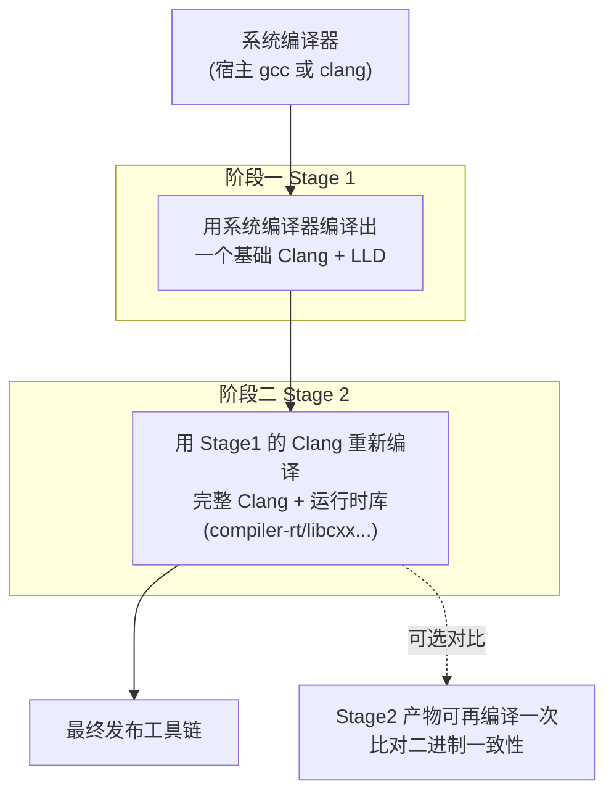

LLVM 提供了一个现成的 CMake 缓存文件 `clang/cmake/caches/DistributionExample.cmake` 来一键配置这种自举。核心机制是 `CLANG_ENABLE_BOOTSTRAP=ON`：配置 stage1 后，执行 `ninja stage2` 会自动用 stage1 的 clang 去配置并构建 stage2。

与 GCC 自举的关键差异：GCC 的三阶段主要为**自验证**（stage2 与 stage3 二进制须逐字节相同）；LLVM 的两阶段更多是为了**用 Clang 优化 Clang** 以及测试新编译器能否正确编译大型 C++ 工程。单纯自用并不强制自举，`stage1` 的 clang 已经完全可用。

### 9.3 关键 CMake 参数详解

一次典型的 stage1 配置命令：

```bash
cmake -G Ninja -S llvm -B build \
  -DCMAKE_BUILD_TYPE=Release \
  -DLLVM_ENABLE_PROJECTS="clang;lld" \
  -DLLVM_ENABLE_RUNTIMES="compiler-rt;libcxx;libcxxabi;libunwind" \
  -DLLVM_TARGETS_TO_BUILD="X86;AArch64;ARM;RISCV" \
  -DCMAKE_INSTALL_PREFIX=/opt/llvm \
  -DLLVM_USE_LINKER=lld \
  -DLLVM_ENABLE_LTO=Thin \
  -DCLANG_ENABLE_BOOTSTRAP=ON
```

| 参数 | 含义 | 对应 GNU 概念 |
|------|------|---------------|
| `-G Ninja` | 用 Ninja 后端（比 make 快，适合增量） | `make` |
| `-S llvm -B build` | 源码在 `llvm/`，构建产物在 `build/`（out-of-tree） | `objdir` 分离 |
| `-DCMAKE_BUILD_TYPE=Release` | 发布优化（`-O3 -DNDEBUG`），`Debug`/`RelWithDebInfo` 可选 | `--enable-checking=release` + cflags |
| `-DLLVM_ENABLE_PROJECTS=` | 构建哪些宿主工具 | `--enable-languages=` |
| `-DLLVM_ENABLE_RUNTIMES=` | 构建哪些目标运行时库 | newlib/glibc/libstdc++ 阶段 |
| `-DLLVM_TARGETS_TO_BUILD=` | **后端支持哪些架构**（一个 clang 可内建多个） | GNU 的 `--target=`（但 GNU 一个编译器只一个 target） |
| `-DCMAKE_INSTALL_PREFIX=` | 安装路径 | `--prefix=` |
| `-DLLVM_USE_LINKER=lld` | 用 lld 加速自身链接 | — |
| `-DLLVM_ENABLE_LTO=Thin` | 对 LLVM 自身做 ThinLTO 优化 | GCC 的 `-flto` |
| `-DCLANG_ENABLE_BOOTSTRAP=ON` | 启用两阶段自举 | GCC bootstrap |

> **最重要的认知差异**：`LLVM_TARGETS_TO_BUILD="X86;AArch64;ARM;RISCV"` 意味着**同一个 clang 二进制同时内建这 4 种架构的后端**。而 GNU 必须为每个 target 单独构建一整条工具链。这是 LLVM 交叉编译"开箱即用"的根本原因。

### 9.4 完整构建实例与输入输出

```bash
# 1. 获取源码（浅克隆特定发布分支）
git clone --depth 1 -b llvmorg-18.1.0 \
    https://github.com/llvm/llvm-project.git
cd llvm-project

# 2. 配置（stage1）
cmake -G Ninja -S llvm -B build \
  -DCMAKE_BUILD_TYPE=Release \
  -DLLVM_ENABLE_PROJECTS="clang;lld" \
  -DLLVM_ENABLE_RUNTIMES="compiler-rt;libcxx;libcxxabi;libunwind" \
  -DLLVM_TARGETS_TO_BUILD="X86;AArch64;ARM;RISCV" \
  -DCMAKE_INSTALL_PREFIX=/opt/llvm

# 3. 构建
ninja -C build

# 4. 运行测试（可选）
ninja -C build check-clang check-llvm

# 5. 安装
ninja -C build install
```

- **输入**：llvm-project 单体源码；宿主需 CMake ≥ 3.20、Ninja、一个 C++17 编译器（gcc 或 clang）、Python。
- **过程**：CMake 探测依赖并生成 `build.ninja`；Ninja 并行编译数千个 TU，先出 `llvm-*` 库与工具，再出 clang，最后编译 runtimes。
- **输出**：`/opt/llvm/bin/` 下得到 `clang`、`clang++`、`lld`（及别名 `ld.lld`）、`llvm-ar`、`llvm-objdump`、`llvm-nm`、`llvm-readobj` 等，外加 `lib/clang/<ver>/` 下的头文件与 `libclang_rt.*`、`lib/libc++.so` 等运行时。

一条自给自足的工具链调用（完全不依赖 GNU binutils）：

```bash
clang --target=aarch64-linux-gnu -fuse-ld=lld \
      -stdlib=libc++ hello.cpp -o hello
```

### 9.5 用 LLVM 做交叉编译

LLVM 交叉编译无需重建工具链，只要在调用时指定目标三元组和 sysroot：

```bash
clang --target=riscv64-unknown-linux-gnu \
      --sysroot=/opt/riscv-sysroot \
      --gcc-toolchain=/opt/riscv-gcc \
      -fuse-ld=lld main.c -o main
```

- `--target=`：目标三元组，切换后端与默认 ABI。
- `--sysroot=`：目标系统的头/库根目录（概念与 GNU 完全一致，见 8.3）。
- `--gcc-toolchain=`：在还没有完整 LLVM 运行时时，复用 GNU 提供的 crt*.o、libc、libgcc（LLVM 与 GNU 组件可混用，这是常见的过渡形态）。

若要完全摆脱 GNU，需要把 `compiler-rt`（替代 libgcc）和 `libc++`（替代 libstdc++）也为目标架构编译出来，并自带一套 libc（如 LLVM 自家的 `llvm-libc`，或 musl/newlib）。

### 9.6 GNU 与 LLVM 构建范式对比

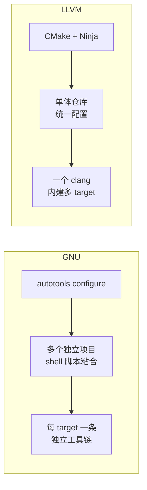

| 维度 | GNU（gnu-devtools-for-arm 实例） | LLVM |
|------|-------------------------------|------|
| 源码组织 | 多个独立 git/tarball，需清单抓取 | 单体仓库 |
| 配置系统 | autotools（`configure`） | CMake |
| 构建驱动 | shell 脚本 + make，手工管理阶段状态机 | Ninja，依赖图自动调度 |
| 自举 | GCC 三阶段（自验证）+ libc 多轮交替 | 可选两阶段 |
| 多 target | 每 target 重建整条链 | 单二进制多后端 |
| 循环依赖处理 | gcc1→libc→gcc2 显式打破 | runtimes 单独阶段，机制类似但由 CMake 编排 |
| 交叉编译 | 构建专用交叉工具链 | `--target=` + `--sysroot=` 即可 |

---

## 10. 实例剖析：crosstool-NG 自动化构建原理

> 前文的 gnu-devtools-for-arm 是"手写脚本"方案，适合深入理解每一步。而生产中更常用**自动化构建器**来屏蔽这些复杂细节。crosstool-NG 是其中最经典、最专注于"构建交叉工具链"的工具。

### 10.1 crosstool-NG 是什么

[crosstool-NG](https://crosstool-ng.github.io/)（"NG" = Next Generation）是一套用于**自动化构建 GNU 交叉工具链**的框架。它的前身是 Dan Kegel 的 `crosstool` 脚本集，后由 Yann Morin 重写为基于 **kconfig**（Linux 内核同款配置系统）的现代工具。

它解决的核心痛点正是前面第 5、6 节展示的复杂性：组件版本搭配、下载、打补丁、自举顺序、sysroot 布局、各种 configure 参数——crosstool-NG 把这些沉淀成**可菜单配置的声明式方案**，用户只需选"我要什么样的工具链"，而不必写构建脚本。

定位区分：

- **crosstool-NG**：只产出**工具链本身**（编译器 + libc + binutils + gdb）。
- **Buildroot / Yocto**：产出**整个嵌入式根文件系统/发行版**，工具链只是其中一环（它们内部甚至可以调用 crosstool-NG 或自带构建器）。

### 10.2 kconfig 配置系统

crosstool-NG 复用 Linux 内核的 Kconfig/menuconfig 界面。整个工具链的所有决策被组织成分层菜单：

```
ct-ng menuconfig
├── Target options          # 目标架构(arm/aarch64/riscv/mips...)、字节序、ABI、CPU
├── Toolchain options       # 三元组命名(vendor 字段)、sysroot 布局
├── Operating System        # 裸机(bare-metal) 还是 linux;内核头文件版本
├── Binary utilities        # binutils 版本与选项
├── C-library               # glibc / musl / uClibc-ng / newlib 选择与版本
├── C compiler              # gcc 版本、启用的语言、是否多阶段
├── Debug facilities        # gdb / strace / ltrace / gdbserver
└── Companion libraries     # gmp/mpfr/mpc/isl/expat 等版本
```

- 用户的选择保存在一个 `.config` 文本文件中（与内核 `.config` 同理），可版本化、可复用、可 diff。
- crosstool-NG 还预置了大量 **sample（预设方案）**，如 `aarch64-unknown-linux-gnu`、`arm-cortexm3-eabi` 等，用 `ct-ng list-samples` 查看，`ct-ng <sample>` 一键载入作为起点。

这相比 gnu-devtools-for-arm 的"命令行长串参数 + shell 脚本"是另一种哲学：**声明式配置文件 vs 命令式脚本**。

### 10.3 内部构建步骤流水线

`ct-ng build` 启动后，内部按固定的 **steps（步骤）** 顺序执行。可用 `ct-ng list-steps` 查看，核心顺序如下：

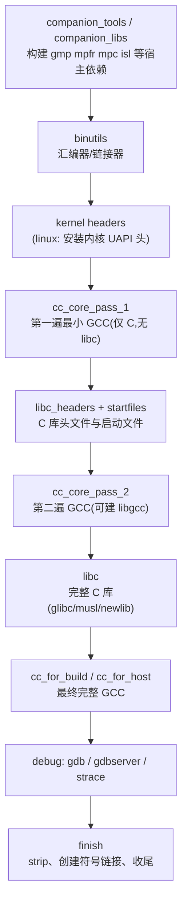

可以看到，crosstool-NG 的 `cc_core_pass_1 → libc_headers → cc_core_pass_2 → libc → cc_for_host` 这条链，**正是第 5、6 节手写脚本里 gcc1→libc-headers→gcc2→libc→gcc3 的自动化封装**。它把我们手工剖析的全部自举逻辑内建成了标准步骤。

每个步骤的产物落在 `.build/` 工作目录，支持**断点续建**：`ct-ng <step>+`（从某步开始）、`ct-ng +<step>`（构建到某步为止）、`ct-ng <step>`（只建某步），对应 gnu-devtools-for-arm 的阶段状态机。调试时可用 `CT_DEBUG_CT_SAVE_STEPS=1` 保存每步快照以便回退。

### 10.4 完整使用实例与输入输出

```bash
# 1. 获取并安装 crosstool-NG
git clone https://github.com/crosstool-ng/crosstool-ng.git
cd crosstool-ng
./bootstrap && ./configure --prefix=/opt/ctng
make && make install
export PATH=/opt/ctng/bin:$PATH

# 2. 从预设列表挑一个起点
ct-ng list-samples
ct-ng aarch64-unknown-linux-gnu      # 载入该 sample 为 .config

# 3. 按需微调(选 glibc/musl 版本、gcc 版本、是否带 gdb 等)
ct-ng menuconfig

# 4. 构建(全程自动下载源码、打补丁、自举)
ct-ng build

# 5. 使用
~/x-tools/aarch64-unknown-linux-gnu/bin/aarch64-unknown-linux-gnu-gcc \
    hello.c -o hello
```

- **输入**：一个 `.config`（描述想要的工具链）。源码由 crosstool-NG 根据配置**自动从各上游下载**到 `$CT_LOCAL_TARBALLS_DIR` 缓存（无需手工准备 src 目录，这与 gnu-devtools-for-arm 需先 `source-fetch.py` 不同）。
- **过程**：按 10.3 的步骤流水线自举，自动应用内置补丁集解决已知的版本兼容问题。
- **输出**：默认在 `~/x-tools/<triple>/` 下得到完整工具链，含 `bin/<triple>-gcc`、`<triple>-g++`、`<triple>-gdb`、sysroot（`<triple>/sysroot/` 里是 target 的 glibc 头与库）。

### 10.5 与手写脚本/其他方案的对比

| 维度 | 手写脚本<br/>(gnu-devtools-for-arm) | crosstool-NG | Buildroot / Yocto |
|------|-----------------------------------|--------------|-------------------|
| 产出 | 工具链 | 工具链 | 整个根文件系统 + 工具链 |
| 配置方式 | 命令行参数 + shell | kconfig `.config` | kconfig / BitBake 配方 |
| 源码获取 | 手工 `source-fetch.py` | 自动下载 + 缓存 | 自动下载 |
| 补丁管理 | 需自行处理 | 内置补丁集 | 内置补丁集 |
| libc 选择 | glibc / newlib | glibc / musl / uClibc-ng / newlib | 多种 |
| 可复现性 | 靠 manifest 锁 commit | `.config` + 版本锁 | 高(层+配方) |
| 适用场景 | 深度定制/研究/官方发布复现 | 快速产出各式交叉工具链 | 完整嵌入式产品 |
| 学习价值 | 看得见每一步原理 | 封装了原理 | 封装程度最高 |

**选型建议**：想**理解原理**或**复现某官方工具链**，读手写脚本（如本文第 6 节）；想**快速、可靠地产出**一条标准交叉工具链，用 crosstool-NG；想**做完整嵌入式系统**，用 Buildroot/Yocto（其内部构建工具链的原理与前两者一脉相承）。

---

## 11. 深入：GCC 三阶段自举的内部机制

> 第 5 节讲的是"交叉工具链"的 gcc1→libc→gcc2 自举（打破 GCC↔libc 循环）。本节讲的是另一种自举——**原生 GCC 自身的三阶段自举（3-stage bootstrap）**，它发生在 `Build=Host=Target` 时，目的是"用 GCC 编译 GCC 并自我验证"。两者名字都叫 bootstrap，但解决的问题不同，切勿混淆。

### 11.1 为什么原生 GCC 要自举三次

当你在一台机器上从源码构建原生 GCC 时，起点只有系统里一个**现成的编译器**（可能是旧版 GCC、Clang，甚至厂商编译器）。直接用它编译一次 GCC 当然能得到可用的编译器，但存在两个问题：

1. **性能/一致性问题**：用"外来编译器"编译出的 GCC，其代码质量、优化行为取决于那个外来编译器，无法保证与"GCC 自己编译自己"的结果一致。
2. **正确性验证缺失**：如何确认新构建的 GCC 没有 bug、能正确编译大型 C/C++ 工程？最严苛的测试莫过于**让它编译自己**。

三阶段自举同时解决这两点，核心思想是：

```
用系统编译器 → 造出 stage1 GCC
用 stage1 GCC → 造出 stage2 GCC    （第一个"GCC 造的 GCC"）
用 stage2 GCC → 造出 stage3 GCC    （第二个"GCC 造的 GCC"）
比较 stage2 与 stage3：应当逐字节相同
```

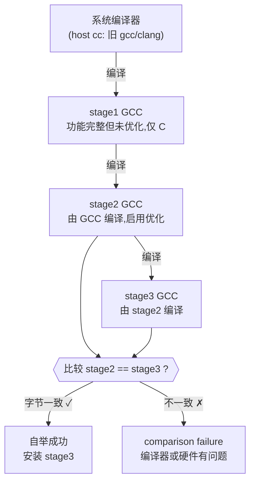

### 11.2 三个阶段分别做什么

| 阶段 | 由谁编译 | 产物与目的 | 典型优化 |
|------|----------|-----------|----------|
| **stage1** | 系统编译器（`$CC`） | 一个"够用"的 GCC，**只编译 C 语言**（因为系统里一定有 C 编译器，C++ 则不一定）。它仅作为造 stage2 的工具，不追求质量。 | 默认 `-O2`，可被 `STAGE1_CFLAGS` 覆盖（常设 `-O0 -g` 加速调试构建） |
| **stage2** | stage1 GCC | 功能完整的 GCC（含 C、C++ 等所有配置的前端）。它是第一个"血统纯正"的 GCC。 | `-O2 -g`（`BOOT_CFLAGS`） |
| **stage3** | stage2 GCC | 与 stage2 用**完全相同的编译器和选项**再编译一遍。 | 同 stage2 |

关键点：**stage2 和 stage3 的编译器（stage1→stage2 用 stage1，stage2→stage3 用 stage2）虽然不同，但如果 GCC 是确定性的、无 bug 的，那么 stage2 这个编译器编译 GCC 源码的结果，应当与 stage3 这个编译器编译同一份源码的结果完全一致**——因为 stage2 本身就是一个合格的 GCC，stage3 也是，它们是"同一个编译器的两次构建"，输出必须一样。

> 为什么是"三"阶段而非两阶段就够比较？因为要比较的是"**两个都由 GCC 产生的编译器**"。stage1 由系统编译器产生，不算数；必须有 stage2（第一个 GCC 产的 GCC）和 stage3（第二个 GCC 产的 GCC）才能两两对比。

### 11.3 比较阶段：二进制一致性验证

构建系统在 stage3 完成后会执行 `compare` 步骤，逐一比对 stage2 与 stage3 的目标文件（`.o`）。GCC 的 Makefile 用 `contrib/compare-all` 式逻辑（实际是 `gcc/Makefile` 里的 `compare` 目标）做这件事：

- 它会**剥离**目标文件中不影响语义的部分（如记录编译时间戳、路径的调试段），再做字节比较。
- 若发现差异，报出经典错误：

```
Bootstrap comparison failure!
gcc/tree.o differs
make: *** [compare] Error 1
```

这种失败通常意味着严重问题之一：

1. GCC 本身存在 bug（优化在"编译自己"时产生了不稳定输出）。
2. **硬件故障**（内存/CPU 不稳定）——自举是极佳的硬件烤机测试，历史上常用来发现超频不稳或坏内存。
3. 使用了非确定性输入（如把绝对路径、时间戳编进了 `.o`）。

因此"bootstrap 通过"是 GCC 质量的重要信号：它证明新编译器强到足以正确编译自身这个超大型 C++ 工程，且结果可复现。

### 11.4 目录布局与 Makefile 机制

在 GCC 构建目录（`objdir`）中，自举产生分层的 stage 目录：

```
objdir/
├── gcc/                     # 当前/最终阶段的工作区
├── prev-gcc/                # 上一阶段产物(供比较)
├── stage1-gcc/   stage1-binutils/ ...   # stage1 各组件
├── stage2-gcc/   stage2-binutils/ ...
├── stage3-gcc/   ...
├── stage_current           # 记录当前处于哪个 stage 的标记文件
└── stage_final             # 指向最终阶段
```

GCC 顶层 `Makefile`（由 `Makefile.tpl` + `Makefile.def` 经 `autogen` 生成）用一组 `stageN-bubble`、`stageN-start`、`stageN-end` 伪目标编排：

```makefile
# 概念示意(非逐字):
all:            ->  bootstrap
bootstrap:      ->  stage3-bubble  compare
stage1-bubble:  ->  配置并 make stage1 的所有组件
stage2-bubble:  ->  stage1-bubble 完成后,用 stage1 编译器 make stage2
stage3-bubble:  ->  stage2-bubble 完成后,用 stage2 编译器 make stage3
```

每进入下一阶段，`stageN-start` 会把上一阶段的 `gcc/` 重命名/链接为 `prev-gcc/`，并把 `stageN-gcc/` 挂成当前 `gcc/`；构建时通过 `CC="$(STAGE_CC_WRAPPER) .../prev-gcc/xgcc -B.../prev-gcc/"` 指定"用上一阶段刚造好的编译器"。`xgcc` 就是尚未安装的、在构建树里直接可运行的 GCC 驱动，`-B` 告诉它去哪找配套的 `cc1`、`as`、`ld`。

### 11.5 自举中的循环依赖与生成文件

GCC 源码里有不少**由程序生成源码再编译**的环节，自举时要小心处理：

- **insn-*.c / 机器描述**：GCC 后端的指令选择、识别代码由 `.md`（machine description）经 `genrecog`、`genemit` 等 *generator 程序* 生成。这些 generator 本身是 C 程序，需要先用"build 编译器"编译出来、在 build 机上运行，产出 `.c`，再用"host/stage 编译器"编译。
- **这引出 build vs host 编译器之分**（见 11.6）。在原生自举里两者相同，但机制上仍分开处理。
- **`contrib/gcc_update --touch`**：源码发行包里已带好自动生成文件，该脚本刷新它们的时间戳，避免 make 误触发"重新生成"（那会要求 autogen/autoconf 等 maintainer 工具）。第 6 节的 gnu-devtools-for-arm 脚本也调用了它，正是同一原因。

### 11.6 BUILD / HOST / TARGET 编译器的三重身份

自举期间，构建系统内部同时维护三种编译器角色（与第 2 节的三机器概念一致，但聚焦在"编译器"实体）：

| 角色 | 作用 | 原生自举时 |
|------|------|-----------|
| **build 编译器** `CC_FOR_BUILD` | 编译"要在构建机上运行的辅助程序"（如 generator、`genrecog`） | = 系统编译器 |
| **host 编译器** `CC` | 编译"组成最终 GCC 的代码"（将运行在 host 上） | = 上一 stage 的 GCC |
| **target 编译器** `CC_FOR_TARGET` | 编译"目标运行时库"（libgcc、libstdc++，运行在 target 上） | = 正在构建的这个 GCC（xgcc） |

原生场景三机器相同，但三种编译器**实体仍不同**（系统 cc、prev-stage gcc、新 xgcc），构建系统必须精确区分，否则会错误链接。理解这一点，也就理解了交叉/加拿大交叉里这三者如何进一步分化。

### 11.7 自举与交叉构建的关系

关键结论：**交叉编译 GCC 时默认不做三阶段自举**。原因很直接——

- stage2、stage3 需要"用新造的 GCC 去编译 GCC"。但交叉工具链里，新造的 GCC 生成的是 **target 代码**，无法在 build 机上运行，自然无法拿它来编译下一阶段（下一阶段的 GCC 要在 build/host 上跑）。
- 所以交叉构建等价于**只做 stage1**（`--disable-bootstrap` 是交叉构建的隐含/常见设置）。

这解释了为什么第 6 节 gnu-devtools-for-arm 这类交叉脚本里看不到 stage2/stage3 比较，而是另一种 gcc1/gcc2/gcc3 自举（那是为打破与 libc 的循环，不是自我验证）。两类自举的对照：

| | 原生三阶段自举 | 交叉工具链的多遍 GCC |
|--|--------------|--------------------|
| 触发条件 | Build=Host=Target 且未 `--disable-bootstrap` | 交叉（Build=Host≠Target） |
| 遍数命名 | stage1/stage2/stage3 | gcc1/gcc2(/gcc3/gcc4) |
| 目的 | 自我验证 + 用 GCC 优化 GCC | 打破 GCC↔libc 循环依赖 |
| 是否比较二进制 | 是（compare） | 否 |
| 各遍编译器运行在 | build 机 | 都在 build 机（生成 target 代码） |

加拿大交叉（Host≠Build）则更特殊，同样不能常规自举，需要先有能在 build 上运行、生成 host 代码的编译器。

### 11.8 实操、常用选项与排错

**触发自举**：原生从源码装 GCC 时，顶层 `make`（即 `make all`）在满足条件时默认等于 `make bootstrap`。也可显式：

```bash
../gcc-src/configure --prefix=/usr/local --enable-languages=c,c++
make bootstrap          # 或 make profiledbootstrap(更慢但生成更快的 GCC)
make install
```

**常用相关选项**：

| 选项 / 变量 | 作用 |
|------------|------|
| `--disable-bootstrap` | 只做 stage1，**大幅缩短构建时间**，开发调试常用 |
| `--enable-bootstrap` | 强制自举（默认在原生构建即开启） |
| `make profiledbootstrap` | 在 stage2 用 `-fprofile-generate`、stage3 用采集到的 profile 做 PGO，产出运行更快的 GCC（代价是更慢、再多一遍） |
| `make bootstrap-lean` | 每进入下一阶段即删除上一阶段，省磁盘 |
| `STAGE1_CFLAGS="-O0 -g"` | 降低 stage1 优化以加速、便于调试 stage1 |
| `BOOT_CFLAGS="-O2 -g"` | 控制 stage2/stage3 的编译选项 |
| `make compare` | 单独执行二进制一致性比较 |
| `make all-host` / `make all-target-libgcc` | 只构建部分，用于定点迭代 |

**典型排错**：

- *comparison failure* → 优先怀疑**硬件（内存/散热）**；其次换 stage1 优化级别重试；再查是否打了不确定性补丁。
- *构建太慢* → 开发期用 `--disable-bootstrap`；只改前端时可 `make all-host` 跳过运行时库。
- *out of memory* → 自举（尤其 LTO/PGO）内存消耗大，限制 `-j` 并行度或加 swap。
- *需要确定性构建* → 设 `SOURCE_DATE_EPOCH`、避免把绝对路径编入，确保可复现。

> 一句话总结：**原生三阶段自举 = "GCC 用自己编译自己两遍并比对"，是正确性与可复现性的黄金标准；交叉构建因新编译器不能在本机跑而退化为单阶段**。理解这组区别，就能分清本文出现的两种 "bootstrap"。

---

## 12. 实例剖析：Buildroot 构建系统

> 第 10 节的 crosstool-NG 只产出"工具链"。Buildroot 则更进一步：它用工具链去编译整个**根文件系统（rootfs）+ 内核 + bootloader**，产出可直接烧录的嵌入式系统镜像。工具链在这里只是第一环，但 Buildroot 对工具链的处理方式很有代表性。

### 12.1 Buildroot 的定位与工具链三种来源

[Buildroot](https://buildroot.org/) 是一套基于 Make + kconfig 的嵌入式 Linux 构建系统，一条命令即可从源码构建出完整的可启动系统。它同样用 `menuconfig` 配置，`.config` 保存选择。

在"工具链"这一环，Buildroot 给出**三种来源**（`Toolchain → Toolchain type`）：

| 类型 | 含义 | 适用 |
|------|------|------|
| **Buildroot toolchain（内部）** | Buildroot **自己从源码构建** binutils+gcc+libc，内部复用与 crosstool-NG 一致的自举逻辑 | 最常用，完全可控 |
| **External toolchain（外部）** | 直接使用**预编译**的第三方工具链（如 ARM/Bootlin 发布的，或自己用 crosstool-NG 造的） | 省时间，或需特定厂商工具链 |
| **ct-ng 集成** | 历史上可桥接 crosstool-NG | 较少用 |

C 库也可选 **glibc / musl / uClibc-ng**——这正是嵌入式领域 libc 选型的集中体现（见术语表）。

### 12.2 package 基础设施与 .mk/Config.in 机制

Buildroot 的核心抽象是 **package**。每个被构建的软件（包括工具链组件 gcc、binutils、glibc）都是一个 package，由两个文件描述：

- **`Config.in`**：声明该 package 的 kconfig 选项（是否启用、版本、子选项），决定它出现在 menuconfig 的哪个菜单。
- **`<pkg>.mk`**：声明如何获取与构建它。

Buildroot 提供一组 **package infrastructure（构建基础设施）** 宏，把"下载→解压→打补丁→配置→编译→安装"标准化。以一个 autotools 包为例：

```makefile
FOO_VERSION = 1.2.3
FOO_SOURCE = foo-$(FOO_VERSION).tar.gz
FOO_SITE = https://example.org/releases
FOO_DEPENDENCIES = host-pkgconf libbar      # 依赖:会先构建这些
FOO_CONF_OPTS = --disable-static            # 传给 ./configure 的参数

$(eval $(autotools-package))                # 关键:套用 autotools 基础设施
```

`$(eval $(autotools-package))` 一行就展开出该包的全部构建规则。其他基础设施还有 `cmake-package`、`kconfig-package`、`generic-package`、`python-package` 等——与第 9 节 LLVM 用 CMake、第 6 节 GNU 用 autotools 的差异在此被统一封装。`host-foo` 前缀表示"构建在 host 上运行的版本"，对应第 11.6 节的 build/host 编译器区分。

### 12.3 工具链在 Buildroot 中的构建顺序

当选"内部工具链"时，Buildroot 的工具链构建顺序与前文的交叉自举完全同构：

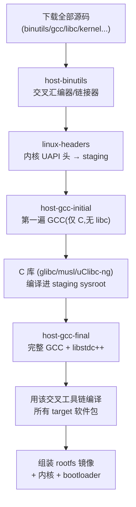

`host-gcc-initial` / `host-gcc-final` 就是第 5、6 节 gcc1/gcc2 的 Buildroot 命名；`staging` 目录即 sysroot。工具链建好后，Buildroot 继续用它编译 BusyBox、库、应用，最后打包成 `rootfs.ext4`/`rootfs.tar` 等镜像。

### 12.4 完整实例与输入输出

```bash
# 1. 获取 Buildroot
git clone https://git.buildroot.net/buildroot
cd buildroot

# 2. 用某开发板预设(defconfig)作起点
make list-defconfigs
make qemu_aarch64_virt_defconfig

# 3. 微调:选 libc、gcc 版本、要装哪些软件
make menuconfig

# 4. 一键构建(下载→造工具链→编译 rootfs→出镜像)
make                      # 可加 -j$(nproc) 交由各包并行

# 5. 产物在 output/images/
ls output/images/         # Image rootfs.ext4 ... 可直接喂给 QEMU/烧录
```

- **输入**：一个 `.config`（或 defconfig）。源码由 Buildroot 按各包 `.mk` 的 `*_SITE` 自动下载到 `dl/` 缓存。
- **过程**：`output/build/` 下逐包构建；工具链产物在 `output/host/`（host 工具）与 `output/staging/`（sysroot）。
- **输出**：`output/images/` 下的可启动镜像；`output/host/bin/` 下带 `<triple>-gcc` 等，可单独拿来做交叉开发。

### 12.5 SDK、external toolchain 与 per-package 目录

- **`make sdk`**：把 `output/host/`（含交叉工具链 + sysroot）打包成可重定位 SDK，发给应用开发者，无需再跑整套 Buildroot。这与第 6 节 gnu-devtools-for-arm 打 `tar.xz` 的意图一致——交付一条可移植工具链。
- **External toolchain 导入**：选 external 后，Buildroot 会校验外部工具链的架构/ABI/libc 是否与配置匹配（防止拿 soft-float 工具链配 hard-float 系统），再把其 sysroot 复制进 staging。
- **per-package 目录（`BR2_PER_PACKAGE_DIRECTORIES`）**：每个包有独立的 host/staging 视图，提升并行度与可复现性，避免包之间相互污染 sysroot。

> 一句话：**Buildroot = kconfig 选配 + package 基础设施标准化构建 + 复用交叉自举造工具链 + 继续编译整系统**。它把前文所有工具链知识封装进"造 rootfs"的大流程里。

---

## 13. RISC-V 工具链的差异

> 前文实例多以 ARM 为主。RISC-V 作为开放、模块化的新兴架构，其工具链在"命名"和"ABI 耦合"上与 ARM 有显著差异，值得单列。原理（binutils/gcc/libc 自举、sysroot、multilib）完全通用，差异主要在参数层面。

### 13.1 模块化 ISA 与命名规则

RISC-V 的指令集是**模块化**的：一个基础整数集 + 若干可选扩展，用字母拼接表达：

| 记号 | 含义 |
|------|------|
| `RV32I` / `RV64I` | 32/64 位基础整数指令集 |
| `M` | 整数乘除 |
| `A` | 原子指令 |
| `F` / `D` | 单/双精度浮点 |
| `C` | 压缩指令（16 位） |
| `G` | = `IMAFD`（"通用"组合的简写） |
| `V` | 向量扩展 |

因此三元组形如 `riscv64-unknown-linux-gnu` 或 `riscv32-unknown-elf`，但**仅看三元组不足以确定代码**——还必须指定 `-march` 精确到扩展，如 `-march=rv64gc`（= RV64 + IMAFD + C）。这与 ARM 用 `armv8-a`、`cortex-m4` 这类"档位"命名的风格很不一样：RISC-V 是"**按需拼装扩展**"。

### 13.2 -march/-mabi 的强耦合

RISC-V 工具链最容易踩的坑是 **`-march` 与 `-mabi` 必须匹配**：

- `-march=` 决定"**允许用哪些指令**"（如是否有 F/D 浮点指令）。
- `-mabi=` 决定"**如何传参、浮点走哪条路**"：`ilp32`/`lp64`（软浮点约定）、`ilp32f`/`lp64f`（单精度硬浮点传参）、`ilp32d`/`lp64d`（双精度硬浮点传参）。

规则：**`-mabi` 需要的浮点能力不能超过 `-march` 提供的**。例如 `-mabi=lp64d` 要求 `-march` 含 `D`，否则报错。常见合法组合：

| -march | -mabi | 场景 |
|--------|-------|------|
| `rv64gc` | `lp64d` | 标准 64 位 Linux（最常见） |
| `rv64imac` | `lp64` | 无浮点的 64 位嵌入式 |
| `rv32imac` | `ilp32` | 32 位 MCU（如很多 RISC-V 单片机） |
| `rv32imafc` | `ilp32f` | 带单精度浮点的 32 位 MCU |

ARM 也有浮点 ABI（`-mfloat-abi`，见 8.1），但 RISC-V 把"指令集扩展"与"ABI"的耦合暴露得更直接、组合更多，构建 multilib 时要为多种 `march/mabi` 对各编译一套库。

### 13.3 riscv-gnu-toolchain 实例

官方 [`riscv-gnu-toolchain`](https://github.com/riscv-collab/riscv-gnu-toolchain) 是一个封装好的超级仓库（含 binutils/gcc/glibc/newlib 作为子模块），用 autotools 风格驱动：

```bash
git clone https://github.com/riscv-collab/riscv-gnu-toolchain
cd riscv-gnu-toolchain

# 裸机工具链(newlib),指定默认 march/abi
./configure --prefix=/opt/riscv --with-arch=rv32imac --with-abi=ilp32
make                 # 产出 riscv32-unknown-elf-gcc ...

# Linux 工具链(glibc)
./configure --prefix=/opt/riscv --with-arch=rv64gc --with-abi=lp64d
make linux           # 产出 riscv64-unknown-linux-gnu-gcc ...

# 多 multilib(为多种 march/abi 组合各建一套库)
./configure --prefix=/opt/riscv --enable-multilib
make                 # 体积大、耗时长
```

- `--with-arch` / `--with-abi`：烧进工具链的**默认** march/abi（用户仍可在编译时用 `-march`/`-mabi` 覆盖到兼容值）。
- `make` vs `make linux`：切换 newlib（裸机）与 glibc（Linux）两条自举路径——内部仍是第 5 节讲的那套 gcc1→libc→gcc2 流程，只是被 Makefile 封装。
- `--enable-multilib`：开启后按预设的 march/abi 矩阵构建多套运行时，对应第 8.2 节 multilib。

### 13.4 与 ARM 工具链的对比小结

| 维度 | ARM | RISC-V |
|------|-----|--------|
| ISA 表达 | 档位式（armv8-a、cortex-m4） | 模块化拼装（rv64gc = RV64+IMAFD+C） |
| 确定代码所需 | 三元组 + `-mcpu`/`-march` | 三元组 + **必须** `-march` + `-mabi` |
| ABI 耦合 | `-mfloat-abi` 相对独立 | `-mabi` 与 `-march` 浮点扩展强绑定 |
| 典型三元组 | `aarch64-none-elf` / `arm-none-eabi` | `riscv64-unknown-elf` / `riscv64-unknown-linux-gnu` |
| 构建原理 | 与 RISC-V **完全相同**（自举/sysroot/multilib） | 同左 |

> 结论：RISC-V 工具链的**构建原理与 ARM 没有本质区别**，差异集中在"如何用字母描述目标"和"march/abi 必须配套"这两件参数层面的事。掌握前文原理后，切到 RISC-V 只需补上 ISA 命名与 ABI 匹配规则。

---

## 14. llvm-libc 现状

> 第 9 节提到完全摆脱 GNU 需要一套非 GNU 的 libc。LLVM 正在自研这样一套——**llvm-libc**。它是 LLVM 工具链"全家桶"的最后一块拼图。

### 14.1 为什么 LLVM 要自造 libc

LLVM 已有 clang（编译器）、lld（链接器）、compiler-rt（替代 libgcc）、libc++（替代 libstdc++），但 **C 标准库仍长期依赖 glibc/musl/newlib**。llvm-libc 旨在补齐这一环，动机包括：

- **许可一致性**：统一在 LLVM 的 Apache-2.0 with LLVM exception 许可下。
- **现代化实现**：用 C++ 实现、强调可测试性、模糊测试、形式化，减少历史包袱。
- **细粒度裁剪**：让嵌入式/特定场景只链接真正用到的函数。
- **与工具链协同**：便于做激进的跨组件优化。

### 14.2 设计特点：细粒度与 full/overlay 两种模式

llvm-libc 的突出设计是**按函数粒度组织**：每个 libc 函数尽量是独立的编译单元与 entrypoint，依赖关系显式声明，便于只取所需、便于测试。

它提供两种使用模式：

| 模式 | 说明 | 用途 |
|------|------|------|
| **overlay（覆盖）模式** | 与现有 libc（glibc 等）**共存**，只用 llvm-libc 提供的部分函数覆盖替换 | 渐进采用、风险低 |
| **full build（完整）模式** | llvm-libc 作为系统**唯一** libc 提供全部功能 | 目标是最终形态，仍在完善 |

### 14.3 成熟度与典型用途

截至目前，llvm-libc 仍处于**积极开发、逐步可用**阶段，成熟度随平台而异：

- **已较实用**：裸机/嵌入式（baremetal）、GPU（作为 LLVM 的 GPU libc 支持 offloading 场景）、以及 x86-64/aarch64 Linux 上的 overlay 模式。
- **仍在推进**：作为桌面 Linux 唯一 libc 的 full build 覆盖面、完整 locale、某些历史接口。
- 不建议用它无条件替换生产系统的 glibc；但在受控的嵌入式、GPU、测试场景已有落地。

> 由于本节涉及快速演进的项目状态，具体函数覆盖率与平台支持请以 [libc.llvm.org](https://libc.llvm.org/) 官方文档的当前版本为准。

### 14.4 在工具链中的位置

把 llvm-libc 放进第 3 节的分层结构，它占据"第 3 层 C 运行时库"，与 glibc/newlib 并列：

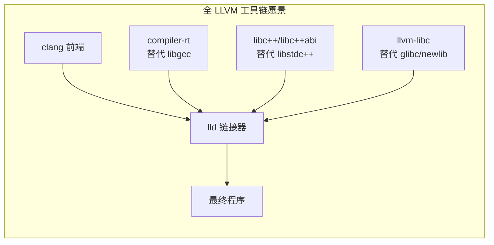

一旦 llvm-libc 成熟，LLVM 即可提供一条**完全不含任何 GNU 组件**的端到端工具链：`clang + lld + compiler-rt + libc++ + llvm-libc`。这与第 9.6 节"GNU vs LLVM"对比表的终局相呼应——届时 GNU 的每一层都有了 LLVM 对位实现。

---

## 15. 实例剖析：Yocto/OpenEmbedded 工具链

> 第 12 节的 Buildroot 用"一棵 Make 树 + kconfig"产出整系统，简单直接。Yocto 则是工业级的发行版构建框架，抽象层级更高、可组合性更强。它构建工具链的方式最能体现第 2、11 节"三类机器 / 三种编译器"概念的工程化落地。

### 15.1 Yocto 与 OpenEmbedded 的关系

容易混淆的三个名字：

| 名称 | 是什么 |
|------|--------|
| **BitBake** | 任务调度与执行引擎（类似加强版 make），解析 recipe、按依赖图并行执行 |
| **OpenEmbedded (OE-Core)** | 一套**元数据/recipe 集合**（包含 gcc、glibc、binutils 等的构建配方），由 BitBake 驱动 |
| **Yocto Project** | 一个**保护伞项目**，提供参考发行版 Poky（= BitBake + OE-Core + 参考配置）、发布节奏与测试体系 |

简单说：**BitBake 是引擎，OpenEmbedded 是配方，Yocto 是把它们整合成可用发行版框架的项目**。实际工作中大家常把三者统称"Yocto"。

### 15.2 recipe、task 与 BitBake 执行模型

Yocto 的核心单元是 **recipe（配方，`.bb` 文件）**，描述一个软件如何构建。每个 recipe 被拆成一串 **task（任务，`do_*`）**，BitBake 按固定顺序执行：

```
do_fetch      → 下载源码（镜像/git/tarball）
do_unpack     → 解压
do_patch      → 打补丁
do_configure  → 配置（autotools/cmake/meson...）
do_compile    → 编译
do_install    → 安装到各自的 sysroot/镜像区
do_populate_sysroot / do_package → 导出头库 / 打包
```

- recipe 可用 `.bbappend` 扩展、用 `.inc` 复用、用**图层（layer）**叠加——这是 Yocto 高可组合性的来源。
- BitBake 为每个 task 计算**签名（signature）**（输入哈希），据此驱动 **sstate 缓存**（见 15.5），实现增量与可复现。

### 15.3 三种编译器与 gcc-cross/gcc-crosssdk

Yocto 把第 11.6 节的"build/host/target 三重编译器"显式拆成不同 recipe，命名很能说明问题：

| recipe | 运行在 | 生成代码运行在 | 对应概念 |
|--------|--------|----------------|----------|
| **gcc-cross** | build 机 | target | 构建 target 软件用的交叉编译器（Build=Host，Target 不同） |
| **gcc-crosssdk** | build 机 | **SDK 的 host** | 为生成可分发 SDK 准备，Host 是未来开发者的机器 |
| **gcc-runtime** | target | target | 在 target 上跑的 libstdc++ 等运行时 |
| **gcc-cross-canadian** | **SDK host** | target | 装进 SDK、运行在开发者机器上的交叉编译器——**正是加拿大交叉**（见第 4.3 节） |

`gcc-cross-canadian` 这个名字直接印证了第 4.3 节：当要做一个"能在开发者 PC（host）上运行、生成 target 代码"的工具链，而它本身是在构建服务器（build）上编译的，三机器全不同，就是 Canadian Cross。Yocto 把这件复杂事做成了标准 recipe。

### 15.4 工具链构建的 recipe 链与流程

构建一个镜像时，Yocto 内部的工具链自举链如下（与第 5、11 节同构，只是 recipe 化）：

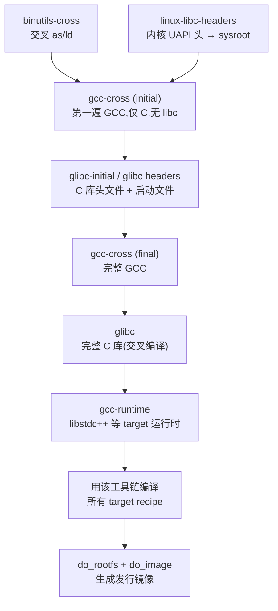

可见 `binutils-cross → gcc-cross(initial) → glibc-headers → gcc-cross(final) → glibc → gcc-runtime` 与 crosstool-NG/Buildroot 的步骤一一对应，只是换成了 BitBake recipe 和 task。

### 15.5 sysroot、sstate 缓存与 SDK

- **per-recipe sysroot**：Yocto 为每个 recipe 维护独立的 `recipe-sysroot`（target 头库）与 `recipe-sysroot-native`（build 工具），避免污染，强可复现。概念同第 8.3 节 sysroot，但隔离更彻底。
- **sstate（shared state）缓存**：每个 task 的输出按签名缓存。改一处配置，BitBake 只重跑受影响的 task，其余从 sstate 秒级恢复——这是 Yocto 相比手写脚本/Buildroot 的最大工程优势。
- **SDK 生成**：`bitbake <image> -c populate_sdk` 产出一个自解压安装脚本，内含 `gcc-cross-canadian` 交叉工具链 + target sysroot，供应用开发者在自己机器上开发，无需 Yocto 全家桶。这与第 6 节 gnu-devtools-for-arm 打 tar、第 12.5 节 Buildroot `make sdk` 目的一致，但自动处理了加拿大交叉。

### 15.6 完整实例与输入输出

```bash
# 1. 获取 Poky(Yocto 参考发行版)
git clone git://git.yoctoproject.org/poky
cd poky

# 2. 初始化构建环境(设置 BUILDDIR、PATH 等)
source oe-init-build-env            # 进入 build/ 目录

# 3. 选机器(编辑 conf/local.conf 的 MACHINE,如 qemuarm64)
#    MACHINE ?= "qemuarm64"

# 4. 构建一个最小镜像(自动先造工具链再编译整系统)
bitbake core-image-minimal

# 5. 单独生成可分发 SDK(含加拿大交叉工具链)
bitbake core-image-minimal -c populate_sdk

# 产物:
#   tmp/deploy/images/<machine>/   镜像
#   tmp/deploy/sdk/                 SDK 自解压安装包
```

- **输入**：图层配置（`bblayers.conf`）+ `local.conf`（选 MACHINE/DISTRO/特性）。源码由各 recipe `do_fetch` 自动下载到 `downloads/`。
- **过程**：BitBake 解析依赖图 → 调度上千 task → sstate 命中则复用 → 先出工具链再编译全系统。
- **输出**：可启动镜像；可选的可重定位 SDK（交叉工具链 + sysroot + 环境脚本 `environment-setup-*`）。

> 对比记忆：**crosstool-NG = 只造工具链；Buildroot = 一棵 Make 树造整系统；Yocto = recipe/layer/sstate 的工业级发行版框架，且把加拿大交叉 SDK 标准化**。三者构建工具链的底层原理（自举、sysroot、三机器）完全一致。

---

## 16. 深入：PGO 与 BOLT 对编译器自身的优化

> 第 11.8 节提到 `make profiledbootstrap`。本节展开讲：编译器也是程序，也能用 PGO、LTO、BOLT 优化——而且"优化编译器自身"收益极高，因为它每天被运行无数次。

### 16.1 为什么要优化编译器自身

GCC/Clang 是 CPU 密集型的大型 C++ 程序，充满分支、虚调用、哈希表查找。把它编译得更快，等于**让全世界每一次编译都加速**。实测中，对 Clang 做 PGO+LTO(+BOLT) 可带来 **约 20%–40%+ 的编译吞吐提升**（具体数字随版本/负载而异）。因此主流发行版发布的 gcc/clang 几乎都经过这类优化。

三种技术作用在不同阶段：

| 技术 | 作用阶段 | 优化什么 |
|------|----------|----------|
| **PGO** (Profile-Guided Optimization) | 编译期（有 profile 指导） | 内联、分支预测、热/冷代码划分 |
| **LTO** (Link-Time Optimization) | 链接期 | 跨编译单元内联与去冗余 |
| **BOLT** (Binary Optimization and Layout Tool) | 链接后（改写成品二进制） | 代码布局、I-cache/iTLB 友好性 |

### 16.2 PGO：基于性能剖析的优化

PGO 是"两趟编译 + 中间一次真实运行采样"：


编译器拿到"哪些分支常走、哪些函数热、调用频率"等真实数据后，能做出远比静态启发式更准的内联与布局决策。代价是构建流程变长，且 profile 需用**有代表性的工作负载**采集（profile 不准反而有害）。

### 16.3 GCC 的 profiledbootstrap

GCC 把 PGO 与三阶段自举结合，就是 `make profiledbootstrap`：

- 在三阶段基础上，让某一阶段用 `-fprofile-generate` 编译出**插桩版 GCC**；
- 用这个插桩 GCC 去**编译 GCC 源码本身**（GCC 编译大型 C++ 工程正是其最典型负载，天然是绝佳 profile）；
- 收集 profile 后，再用 `-fprofile-use` 编译出最终的优化版 GCC。

这巧妙之处在于：**不需要外部基准，编译器编译自己就是最真实的 profile 场景**。流程比普通 bootstrap 多一遍、更慢，但产出的 GCC 明显更快。第 11.3 节的二进制比较在 profiled 模式下会相应放宽。

### 16.4 Clang 的多阶段 PGO/LTO

LLVM 提供现成的多阶段 CMake 缓存（如 `clang/cmake/caches/` 下的相关配置）把这套自动化：

1. **stage1**：普通 clang。
2. **instrumented stage**：用 stage1 构建带 `-fprofile-generate` 的插桩 clang。
3. **采样**：用插桩 clang 编译一批代表性代码（LLVM 自带 training 数据或用户提供）。
4. **stage2（最终）**：用 profile + ThinLTO 构建发布版 clang。

对应参数与第 9 节衔接：`LLVM_BUILD_INSTRUMENTED=IR`、`LLVM_ENABLE_LTO=Thin`、`CLANG_BOOTSTRAP_PASSTHROUGH` 等。PGO 与第 9.2 节的两阶段自举是同一套 bootstrap 框架的不同配置。

### 16.5 BOLT：链接后二进制布局优化

[BOLT](https://github.com/llvm/llvm-project/tree/main/bolt)（现为 LLVM 子项目）与 PGO 互补：它不碰源码，而是**对已链接好的可执行文件做"后处理"**：

- 用 Linux `perf` 采集运行时的执行轨迹（哪些函数/基本块相继执行）。
- BOLT 据此**重排函数与基本块的物理布局**，把热代码聚到一起、冷代码移走，优化指令缓存（I-cache）与 iTLB 命中率、减少分支跳转开销。
- 输出一个布局优化后的新二进制。

典型流程：

```bash
# 1. 以便于 BOLT 处理的方式链接(保留重定位)
clang ... -Wl,--emit-relocs -o clang.orig
# 2. 采样
perf record -e cycles:u -j any,u -- ./clang.orig <编译一批代码>
perf2bolt -p perf.data -o clang.fdata clang.orig
# 3. 改写布局
llvm-bolt clang.orig -o clang.bolt -data=clang.fdata \
          -reorder-blocks=ext-tsp -reorder-functions=hfsort -split-functions
```

BOLT 对 clang/gcc 自身能在 PGO+LTO 之上**再叠加约 10%+** 的提升，因为 I-cache 行为是 PGO 难以完全覆盖的维度。许多发行版的 clang 现已 "PGO + ThinLTO + BOLT" 三连。

### 16.6 组合效果与流水线全景

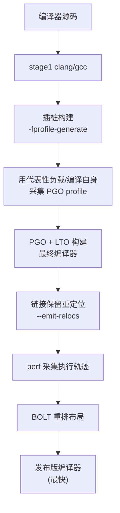

| 技术 | 需要 profile? | 改源码/二进制? | 典型增益（叠加） |
|------|--------------|----------------|------------------|
| LTO | 否 | 编译/链接期 | 基线 |
| PGO | 是（编译期 profile） | 编译期 | 显著 |
| BOLT | 是（运行期 perf） | 成品二进制 | 在前两者之上再加 |

> 一句话：**PGO 让编译器"按真实热度编译自己"，LTO 跨单元优化，BOLT 再把成品的代码布局按运行轨迹重排——三者叠加让发布版编译器达到最快**。这也是 `profiledbootstrap` 存在的意义。

---

## 17. 裸机启动与链接脚本细节

> 第 4.2、8.5 节提到裸机无 OS、靠 crt0 启动。本节深入"从上电到 main"这条链，以及控制它的**链接脚本（linker script）**——这是嵌入式工具链使用中最常被忽视却最关键的一环。

### 17.1 从上电到 main 的完整链条

有 OS 时，程序由内核加载器拉起；裸机则一切自理：

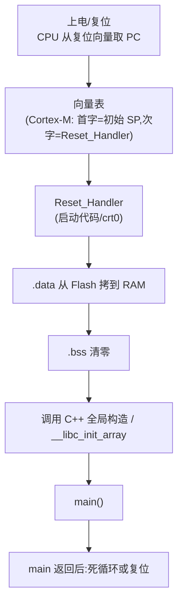

链接脚本的职责，就是**决定上面每一块（向量表、.text、.data、.bss、栈、堆）放在哪段物理地址，并提供启动代码需要的符号**（如 `.data` 的加载地址与运行地址、`.bss` 的起止）。

### 17.2 内存布局与链接脚本结构

一个典型 MCU 有两类存储：**Flash（只读、存代码和初值）** 与 **RAM（可读写、存变量和栈堆）**。关键概念是 section 的 **LMA（加载地址）vs VMA（运行地址）**：

- `.text`（代码）、`.rodata`（常量）：LMA=VMA=Flash，直接在 Flash 里执行。
- `.data`（有初值的全局变量）：**初值存在 Flash（LMA），运行时变量住在 RAM（VMA）**，所以启动代码必须把它从 Flash 拷到 RAM。
- `.bss`（零初值变量）：只在 RAM 占位，无需存初值，启动时清零即可。

链接脚本三大块：

```
MEMORY { ... }      # 声明各物理存储区的起始与大小
SECTIONS { ... }    # 把输入 section 映射到输出 section 与地址
符号定义            # 导出 _sdata/_edata/_sbss/_ebss/_estack 等供 crt0 使用
```

### 17.3 启动代码 crt0/startup 做什么

`Reset_Handler`（GNU 世界常来自 newlib 的 crt0 或芯片厂商的 `startup_xxx.s`）按序完成：

1. 设置栈指针（Cortex-M 由硬件从向量表首字自动加载，其他架构需手动设 SP）。
2. 把 `.data` 从 `_sidata`(Flash) 拷到 `_sdata.._edata`(RAM)。
3. 把 `.bss`(`_sbss.._ebss`) 清零。
4. 调用 `__libc_init_array`（执行 C++ 全局构造函数、`__attribute__((constructor))`）。
5. 跳转 `main`。
6. `main` 返回后进入死循环（裸机无处可返回）。

这几步用到的 `_sdata`、`_edata`、`_sbss`、`_ebss` 等符号，全部由链接脚本提供——这就是脚本与启动代码的契约。

### 17.4 实例：一个最小 Cortex-M 链接脚本

```ld
/* 1. 声明物理内存 */
MEMORY
{
  FLASH (rx)  : ORIGIN = 0x08000000, LENGTH = 512K
  RAM   (rwx) : ORIGIN = 0x20000000, LENGTH = 128K
}

_estack = ORIGIN(RAM) + LENGTH(RAM);   /* 栈顶 = RAM 末尾 */

SECTIONS
{
  /* 2. 向量表必须在 Flash 最前(复位时 CPU 从这里取 SP 和 Reset_Handler) */
  .isr_vector : { KEEP(*(.isr_vector)) } > FLASH

  /* 3. 代码与只读数据,留在 Flash */
  .text   : { *(.text*) *(.rodata*) } > FLASH

  /* 4. .data:VMA 在 RAM,LMA 在 Flash(AT> FLASH) */
  _sidata = LOADADDR(.data);            /* 初值在 Flash 的地址 */
  .data : {
    _sdata = .;                         /* RAM 中 .data 起始 */
    *(.data*)
    _edata = .;                         /* RAM 中 .data 结束 */
  } > RAM AT> FLASH

  /* 5. .bss:仅 RAM,启动时清零 */
  .bss : {
    _sbss = .;
    *(.bss*) *(COMMON)
    _ebss = .;
  } > RAM
}
```

要点解读：

- `KEEP(...)`：防止链接器 `--gc-sections`（见 8.6）把看似无人引用的向量表丢弃。
- `> FLASH` 指定 VMA 所属区；`AT> FLASH` 额外指定 `.data` 的 LMA 也在 Flash——**VMA≠LMA 正是"初值存 Flash、变量在 RAM"的机制**。
- `LOADADDR(.data)` 取出 `.data` 的 LMA 给 `_sidata`，crt0 据此拷贝。
- `_estack`、`_sdata/_edata/_sbss/_ebss` 都是**给启动代码用的契约符号**。

### 17.5 与工具链构建选项的关联

链接脚本和启动文件通过 **specs 文件**与工具链挂钩，这正好呼应第 6.4 节：

- newlib 的 `--specs=nano.specs`（小体积 C 库）、`--specs=rdimon.specs`（semihosting，I/O 转交调试器）、`--specs=nosys.specs`（空桩）决定链接哪套 crt0/libgloss 与系统调用实现。
- 第 6.4 节脚本里 `ldflags_for_target="-specs rdimon.specs"` 就是给裸机库指定默认 specs。
- 芯片厂商的 BSP 通常自带 `startup_<chip>.s` + `<chip>.ld`，替换 newlib 默认启动，适配具体内存映射。
- `-ffunction-sections -fdata-sections` + `-Wl,--gc-sections`（8.6 节）配合链接脚本可最大化裁剪固件体积。

> 一句话：**链接脚本回答"代码和数据放哪、符号怎么给启动代码"，crt0 回答"上电后怎么把 C 运行环境搭起来"，specs 文件把它们和工具链里的库绑定**。这三者是裸机能跑起 main 的最后拼图。

---

## 18. Windows / LLVM-MinGW 工具链

> 第 4.3、6.3 节讲过用加拿大交叉造 Windows 版工具链。本节聚焦 Windows 平台本身的工具链生态，特别是 **LLVM-MinGW**——GNU 与 LLVM 两套体系在 Windows 上的交汇点。

### 18.1 Windows 工具链的三条路线

在 Windows 上做 C/C++ 开发，工具链主要有三条路线：

| 路线 | 编译器 | C 运行时 | ABI | 特点 |
|------|--------|----------|-----|------|
| **MSVC** | cl.exe | UCRT / MSVCRT | MSVC ABI | 微软官方，与 Windows SDK 深度集成 |
| **MinGW-w64 (GCC)** | gcc | **MSVCRT/UCRT**（系统自带） | 近似 MSVC 的 Itanium 变体 | 用 GNU 工具链生成**原生 Windows PE** 程序，无需运行时 DLL 层 |
| **Cygwin** | gcc | cygwin1.dll（POSIX 仿真层） | POSIX | 提供完整 POSIX 环境，程序依赖 cygwin DLL |

关键区别：**MinGW-w64 生成的是真正的原生 Windows 程序**（直接调用 Win32 API、链接系统 `msvcrt`/`ucrt`），不像 Cygwin 需要 POSIX 仿真层。它是"用 GNU 工具链产 Windows 原生二进制"的主力，三元组形如 `x86_64-w64-mingw32`、`i686-w64-mingw32`。

### 18.2 MinGW-w64 的构成

MinGW-w64 本身**不是编译器**，而是让 GCC/Clang 能产 Windows 程序所需的**头文件 + 导入库 + 运行时**：

- **Windows API 头文件**（`windows.h` 等）与对应的**导入库**（`libkernel32.a` 等，链接期解析 Win32 API 符号，运行期由系统 DLL 提供）。
- **CRT 启动代码**（`crt2.o` 等）与 **libmingwex**（补充 C 标准库里 msvcrt 缺失的部分，如部分 C99 数学/格式化函数）。
- 可选的 **winpthreads**（POSIX 线程封装）、**libgcc**（GCC 运行时）。

因此"MinGW 工具链" = GCC/Clang + binutils/lld + MinGW-w64（头/库/CRT）。第 6 节 gnu-devtools-for-arm 构建 MinGW 版工具链时，正是把 target 库（newlib 等）与 MinGW host 环境组合——这就是加拿大交叉。

### 18.3 LLVM-MinGW：基于 LLVM 的 MinGW

[LLVM-MinGW](https://github.com/mstorsjo/llvm-mingw) 用 **LLVM 全家桶替换 GNU 组件**，但仍沿用 MinGW-w64 的头/库，从而产出原生 Windows 程序：

| 组件 | 传统 MinGW (GNU) | LLVM-MinGW |
|------|------------------|------------|
| 编译器 | gcc | clang |
| 链接器 | ld.bfd | lld |
| 汇编/工具 | binutils | llvm-* |
| C++ 库 | libstdc++ | libc++ |
| 编译器运行时 | libgcc | compiler-rt |
| 展开 | libgcc_eh | libunwind |
| Windows 头/库 | **MinGW-w64**（两者共用） | **MinGW-w64** |

LLVM-MinGW 的独特优势：

- **单一工具链支持多架构**：靠 clang 的多后端特性，一套安装即可产 `x86_64 / i686 / aarch64 / armv7` 的 Windows PE（传统 GNU MinGW 每架构要一条独立工具链）——这正是第 9.1、13.4 节"clang 单二进制多 target"的实际红利。
- 原生支持 ARM64 Windows，便于为 Windows on ARM 交叉编译。
- 可生成带现代特性（如 ASan、更好的 C++ 支持）的 Windows 程序。

### 18.4 实例与输入输出

LLVM-MinGW 通常以**预构建 SDK** 形式发布，也可从源码构建（本质是组合 llvm-project + mingw-w64 源码）。使用示例（交叉编译，在 Linux/macOS 上产 Windows 程序）：

```bash
# 假设已安装 llvm-mingw 到 PATH
# 为 64 位 Windows 编译
x86_64-w64-mingw32-clang hello.c -o hello.exe
# 为 ARM64 Windows 编译(同一套工具链!)
aarch64-w64-mingw32-clang hello.c -o hello-arm64.exe
# C++ (用 libc++)
x86_64-w64-mingw32-clang++ app.cpp -o app.exe
```

- **输入**：普通 C/C++ 源码；工具链自带 MinGW-w64 头/库。
- **过程**：clang 产 PE/COFF 目标 → lld（`lld-link` 的 MinGW 驱动）链接系统导入库 → 原生 `.exe`。
- **输出**：可直接在对应架构 Windows 上运行的 `.exe`/`.dll`，默认不依赖额外运行时 DLL（可静态链接 libc++/compiler-rt）。

从源码构建时，`x86_64-w64-mingw32-clang` 这类命令其实是**薄封装脚本**，内部调用 `clang --target=x86_64-w64-mingw32 --sysroot=<mingw-sysroot>`——与第 9.5 节的交叉编译机制完全一致。

### 18.5 与前文加拿大交叉的衔接

把本节放回第 4.3 节的框架：

- 用 **GNU** 造 Windows 版 ARM 交叉工具链 = 典型加拿大交叉，需先造 Linux 版辅助工具链（第 6.3 节 README 步骤）。
- 用 **LLVM-MinGW** 时，由于 clang 天生多 target、多 host 支持更统一，"造一个运行在 Windows 上的工具链"相对简化，但本质仍是 Build/Host/Target 的协调。
- 两条路线都依赖 **MinGW-w64** 这套"Windows 原生 ABI 的头/库"，它是 GNU 与 LLVM 在 Windows 上的公共地基。

> 一句话：**MinGW-w64 提供"产 Windows 原生程序"的头/库地基；传统 MinGW 在其上用 GNU，LLVM-MinGW 在其上用 LLVM 并借 clang 多后端实现一套工具链产多架构 Windows 程序**。

---

## 19. 术语表

| 术语 | 全称 / 含义 |
|------|------|
| **binutils** | Binary Utilities，含 as、ld、ar、objdump 等 |
| **GCC** | GNU Compiler Collection |
| **glibc** | GNU C Library，面向有 OS 的系统 |
| **newlib** | 面向裸机/嵌入式的轻量 C 库；**newlib-nano** 为其最小化变体 |
| **libgloss** | newlib 的底层 BSP/系统调用桩层（含 semihosting） |
| **libgcc** | GCC 的底层运行时（软件除法、异常展开等） |
| **sysroot** | 交叉编译时存放 target 头文件与库的假根目录 |
| **multilib** | 同架构多变体的多份运行时库 |
| **triple / 三元组** | `机器-厂商-系统[-ABI]` 的配置标识 |
| **bootstrap / 自举** | 两义：①交叉构建中分阶段打破 GCC↔libc 循环；②原生 GCC 三阶段自我编译验证 |
| **三阶段自举 (3-stage bootstrap)** | 原生 GCC 用系统编译器造 stage1，再 stage1→stage2→stage3，比对 stage2/stage3 一致性 |
| **comparison failure** | stage2 与 stage3 二进制不一致的自举错误，常指向编译器 bug 或硬件故障 |
| **xgcc** | 构建树中尚未安装、可直接运行的 GCC 驱动程序 |
| **CC_FOR_BUILD / CC / CC_FOR_TARGET** | 自举中的 build/host/target 三重编译器身份 |
| **Canadian Cross** | Build/Host/Target 三者皆不同的交叉构建 |
| **semihosting** | 裸机程序借调试器/仿真器完成 I/O 的机制 |
| **DejaGnu** | 基于 Expect/Tcl 的 GNU 测试框架 |
| **Fast Models** | Arm 官方的周期/行为级处理器模型 |
| **Morello / purecap** | Arm CHERI 能力指针实验架构 |
| **LLVM monorepo** | llvm-project 单体仓库，含 clang/lld/compiler-rt 等 |
| **clang** | LLVM 的 C/C++/Obj-C 前端，单二进制支持多后端 |
| **lld** | LLVM 链接器 |
| **compiler-rt** | LLVM 编译器运行时，相当于 libgcc |
| **libc++ / libc++abi** | LLVM 的 C++ 标准库及 ABI 层，相当于 libstdc++ |
| **ThinLTO** | LLVM 的可扩展链接时优化 |
| **crosstool-NG** | 基于 kconfig 的交叉工具链自动化构建框架 |
| **kconfig / menuconfig** | Linux 内核同款的菜单式配置系统 |
| **musl / uClibc-ng** | 面向嵌入式的轻量级 Linux C 库（glibc 替代） |
| **Buildroot / Yocto** | 构建整个嵌入式根文件系统的框架 |
| **package 基础设施** | Buildroot 中 `autotools-package`/`cmake-package` 等标准化构建宏 |
| **staging / defconfig** | Buildroot 的 sysroot 目录 / 开发板预设配置 |
| **external toolchain** | Buildroot 导入的预编译第三方工具链 |
| **模块化 ISA** | RISC-V 以基础集 + 可选扩展（IMAFDC...）拼装指令集 |
| **-march / -mabi** | RISC-V 指令集扩展选择 / ABI，二者须浮点能力匹配 |
| **rv64gc / lp64d** | 常见 RISC-V 64 位 Linux 的 march/abi 组合 |
| **llvm-libc** | LLVM 自研 C 标准库，支持 overlay 与 full build 两模式 |
| **overlay / full build** | llvm-libc 与现有 libc 共存 / 作为唯一 libc 两种用法 |
| **BitBake / recipe / layer** | Yocto 的执行引擎 / 构建配方(.bb) / 可叠加的元数据图层 |
| **OpenEmbedded / Poky** | Yocto 的 recipe 集合 / 参考发行版 |
| **sstate (shared state)** | Yocto 按签名缓存 task 输出的增量复用机制 |
| **gcc-cross-canadian** | Yocto 中装进 SDK、运行于开发者机的加拿大交叉编译器 |
| **PGO** | Profile-Guided Optimization，按真实运行剖析指导的优化 |
| **profiledbootstrap** | GCC 把 PGO 与三阶段自举结合的构建目标 |
| **LTO / ThinLTO** | 链接时优化 / LLVM 的可扩展 LTO |
| **BOLT** | 对已链接二进制按运行轨迹重排代码布局的后处理优化器 |
| **LMA / VMA** | section 的加载地址（存储处）/ 运行地址（执行处） |
| **链接脚本 (linker script)** | 控制 section 地址映射与符号定义的 `.ld` 文件 |
| **crt0 / startup** | 裸机启动代码：建栈、拷 .data、清 .bss、调构造、跳 main |
| **specs 文件** | 把 crt0/库/系统调用实现与工具链绑定（nano/rdimon/nosys.specs） |
| **MinGW-w64** | 产 Windows 原生 PE 程序所需的头/导入库/CRT 地基 |
| **LLVM-MinGW** | 用 LLVM 组件 + MinGW-w64，单工具链产多架构 Windows 程序 |
| **PE/COFF** | Windows 可执行/目标文件格式（对应 Linux 的 ELF） |

---

## 附录：文档维护说明

- 本文档基于 `gnu-devtools-for-arm` 仓库某次快照分析编写；仓库演进后，脚本行号与阶段名可能变化，引用时以实际源码为准。
- LLVM / crosstool-NG / Buildroot / Yocto / RISC-V / llvm-libc / LLVM-MinGW 等章节的命令、参数、步骤名以各自项目当前发布为准，升级后可能微调；llvm-libc 处于快速演进中，成熟度请以 libc.llvm.org 当前文档为准。
- 已覆盖：GNU 手写脚本实例（第 6 节）、LLVM 从源码构建实例（第 9 节）、crosstool-NG 自动化原理（第 10 节）、GCC 三阶段自举内部机制（第 11 节）、Buildroot 构建系统（第 12 节）、RISC-V 工具链差异（第 13 节）、llvm-libc 现状（第 14 节）、Yocto/OpenEmbedded 工具链（第 15 节）、PGO/BOLT 编译器自优化（第 16 节）、裸机启动与链接脚本（第 17 节）、Windows/LLVM-MinGW（第 18 节）。
- 后续可扩展方向：链接器内部（符号解析/重定位/relaxation）细节、调试信息(DWARF)与 GDB 原理、容器化可复现构建、Rust/其他语言工具链与 LLVM 的集成。
